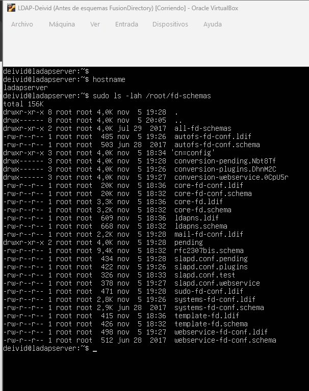
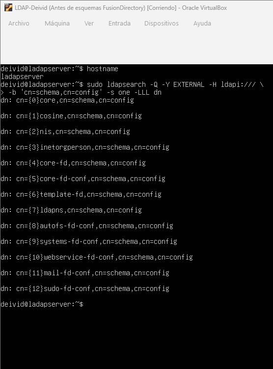
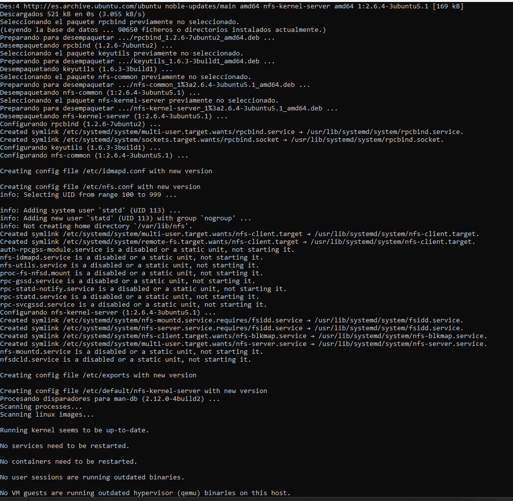
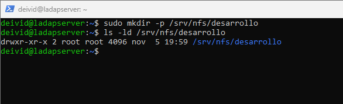
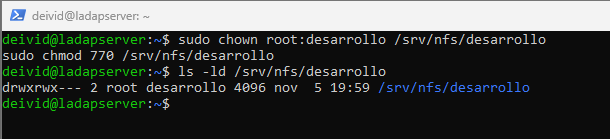
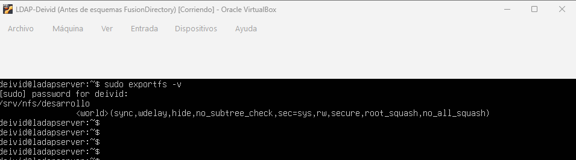
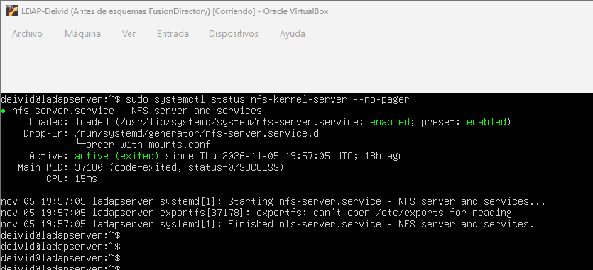
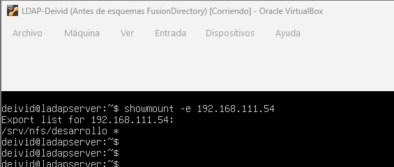
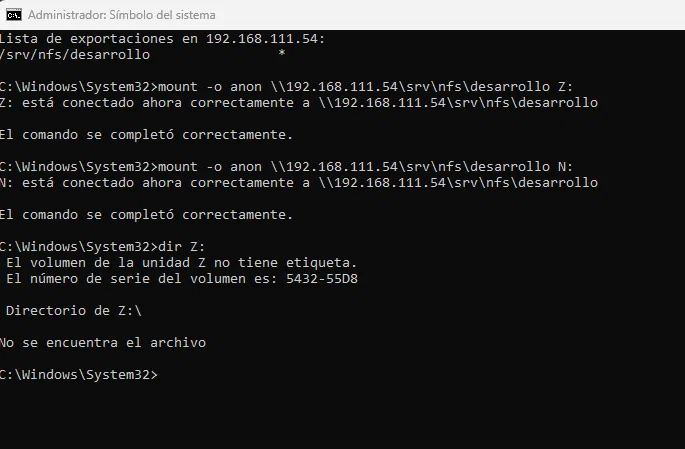
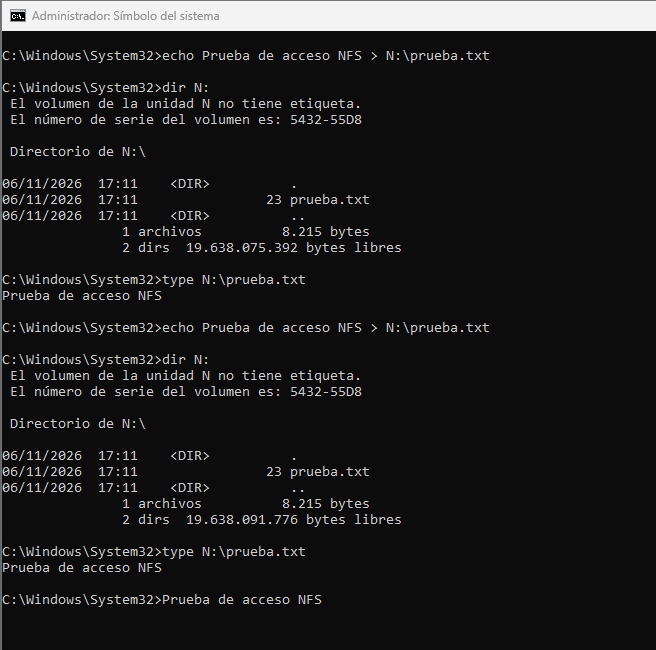

# ACT10 — Manual de operaciones: FusionDirectory, OpenLDAP y NFS

Profesor: Quim.

## Índice

1. [Objetivo](#1-objetivo)
2. [Entorno](#2-entorno)
3. [Administración con FusionDirectory](#3-administración-con-fusiondirectory)
4. [Despliegue y esquemas de FusionDirectory](#4-despliegue-y-esquemas-de-fusiondirectory)
   - [4.1. Arquitectura](#41-arquitectura)
   - [4.2. Archivos de trabajo](#42-archivos-de-trabajo)
   - [4.3. Conversión a LDIF](#43-conversión-a-ldif)
   - [4.4. Verificación de esquemas cargados](#44-verificación-de-esquemas-cargados)
   - [4.5. Incidencia de plugins](#45-incidencia-de-plugins)
5. [Despliegue y pruebas NFS](#5-despliegue-y-pruebas-nfs)
6. [Inventario de evidencias](#6-inventario-de-evidencias)
7. [Conclusiones de la actividad](#7-conclusiones-de-la-actividad)

## 1. Objetivo

Elaborar un manual de operaciones que permita administrar un entorno de usuarios y grupos centralizados con OpenLDAP mediante FusionDirectory y utilizar esas identidades para gestionar el acceso a un recurso compartido NFS. La práctica parte del servidor LDAP existente e incorpora la configuración de FusionDirectory, la preparación de los esquemas necesarios, la administración de grupos POSIX y el despliegue del recurso compartido. El manual recoge los procedimientos, los comandos de comprobación y la resolución de incidencias para que las operaciones puedan repetirse y verificarse, incluyendo las pruebas de acceso desde un cliente Windows.

## 2. Entorno

| Elemento | Valor |
|---|---|
| Servidor Linux | `ladapserver` |
| Dominio y base DN | `dc=hoostlock,dc=lan` |
| Rama de usuarios | `ou=usuarios` |
| Rama de grupos POSIX | `ou=grupos` |
| Contenedor web | `fusiondirectory` |
| Interfaz web | `http://127.0.0.1:8080/fd/` |
| Administrador web | `fd-admin` |
| Grupos existentes | `desarrollo`, `usuarios` |
| Grupo creado | `soporte` |
| Directorio de esquemas en el servidor | `/root/fd-schemas` |
| Servidor NFS utilizado | `192.168.111.54` |
| Recurso NFS | `/srv/nfs/desarrollo` |
| Identidad de prueba documentada | `dcardona`, UID `20001`, GID `20000` |

## 3. Administración con FusionDirectory

### 3.1. Acceso administrativo

He accedido a FusionDirectory con `fd-admin`. La pantalla principal muestra:

```text
Welcome System Administrator!
Signed in: fd-admin
```


### 3.2. Inspección del directorio

He revisado el árbol LDAP y las unidades organizativas antes de modificar la configuración.


Tras la inicialización, he comprobado que el directorio queda accesible desde la interfaz web.


### 3.3. Rama de grupos POSIX

En Configuration → Plugins he configurado:

```text
POSIX groups RDN = ou=grupos
```

La rama de administración de grupos queda en `ou=grupos,dc=hoostlock,dc=lan`.


### 3.4. Grupos existentes

En Groups and roles he comprobado que aparecen `desarrollo` y `usuarios`, tras configurar la rama de grupos POSIX.

### 3.5. Creación del grupo soporte

| Campo | Valor |
|---|---|
| Base | `ou=grupos,dc=hoostlock,dc=lan` |
| Name | `soporte` |
| Force GID | Desactivado |
| GID | Asignación automática |
| Group members | Sin miembros iniciales |
| System trust | `disabled` |

El nuevo grupo aparece junto a `desarrollo` y `usuarios`.


## 4. Despliegue y esquemas de FusionDirectory

### 4.1. Arquitectura

La interfaz web de FusionDirectory se ejecuta en el contenedor `fusiondirectory`. He realizado las comprobaciones de archivos y las consultas al socket LDAP desde la terminal del servidor Linux `ladapserver`.

| Componente | Función |
|---|---|
| `ladapserver` | Servidor Linux que contiene el directorio de trabajo `/root/fd-schemas` |
| `fusiondirectory` | Contenedor de la interfaz web de administración |
| OpenLDAP | Servicio de directorio cuya configuración dinámica se consulta mediante `ldapi:///` desde el servidor |
| `fd-schema-source` | Fuente de esquemas utilizada en el procedimiento de extracción; estado actual sin comprobar |

Los comandos sobre `/root/fd-schemas` se ejecutan en el servidor, no dentro del contenedor web. Para consultar los contenedores se utiliza:

```bash
sudo docker ps -a
```

### 4.2. Archivos de trabajo

He comprobado el nombre del servidor y el contenido del directorio de esquemas:

```bash
hostname
sudo ls -lah /root/fd-schemas
```

La salida identifica el equipo como `ladapserver` y muestra los archivos de preparación y conversión.

| Tipo | Ejemplos observados |
|---|---|
| Esquemas originales | `core-fd.schema`, `core-fd-conf.schema`, `template-fd.schema`, `autofs-fd-conf.schema`, `systems-fd-conf.schema`, `webservice-fd-conf.schema` |
| Archivos LDIF | `core-fd.ldif`, `core-fd-conf.ldif`, `template-fd.ldif`, `ldapns.ldif`, `autofs-fd-conf.ldif`, `systems-fd-conf.ldif`, `webservice-fd-conf.ldif`, `mail-fd-conf.ldif`, `sudo-fd-conf.ldif` |
| Configuraciones temporales | `slapd.conf.test`, `slapd.conf.plugins`, `slapd.conf.webservice`, `slapd.conf.pending` |
| Directorios de trabajo | `all-fd-schemas`, `pending` y directorios de conversión |



El procedimiento de extracción de un esquema desde `fd-schema-source` utiliza este patrón, ejecutado en el anfitrión Docker:

```bash
docker cp "fd-schema-source:/etc/ldap/schema/fusiondirectory/<esquema>.schema" ./<esquema>.schema
```

### 4.3. Conversión a LDIF

Los archivos `.schema` se utilizan para preparar los LDIF que se importan en la configuración dinámica de OpenLDAP. Los comandos siguientes son plantillas: los valores entre `< >` deben sustituirse por los nombres correspondientes, respetando las dependencias entre esquemas.

Desde el directorio de trabajo del servidor, con permisos adecuados:

```bash
cd /root/fd-schemas
cp slapd.conf.test slapd.conf.<nombre>
printf '\ninclude /root/fd-schemas/<esquema>.schema\n' >> slapd.conf.<nombre>
TMP=$(mktemp -d /root/fd-schemas/conversion.XXXXXX)
slaptest -f "$PWD/slapd.conf.<nombre>" -F "$TMP"
```

El LDIF preparado para la importación contiene una estructura de este tipo. Los puntos suspensivos representan las definiciones de atributos y clases del esquema:

```ldif
dn: cn=<esquema>,cn=schema,cn=config
objectClass: olcSchemaConfig
cn: <esquema>
olcAttributeTypes: ...
olcObjectClasses: ...
```

La carga del archivo preparado se realiza con:

```bash
ldapadd -Q -Y EXTERNAL -H ldapi:/// -f <esquema>.ldif
```

### 4.4. Verificación de esquemas cargados

Desde la terminal del servidor `ladapserver` he consultado los esquemas existentes en OpenLDAP:

```bash
sudo ldapsearch -Q -Y EXTERNAL -H ldapi:/// \
  -b 'cn=schema,cn=config' -s one -LLL dn
```

La salida muestra los esquemas generales `core`, `cosine`, `nis` e `inetorgperson`, además de los siguientes nueve esquemas:

| Esquema | Entrada observada |
|---|---|
| `core-fd` | `cn={4}core-fd,cn=schema,cn=config` |
| `core-fd-conf` | `cn={5}core-fd-conf,cn=schema,cn=config` |
| `template-fd` | `cn={6}template-fd,cn=schema,cn=config` |
| `ldapns` | `cn={7}ldapns,cn=schema,cn=config` |
| `autofs-fd-conf` | `cn={8}autofs-fd-conf,cn=schema,cn=config` |
| `systems-fd-conf` | `cn={9}systems-fd-conf,cn=schema,cn=config` |
| `webservice-fd-conf` | `cn={10}webservice-fd-conf,cn=schema,cn=config` |
| `mail-fd-conf` | `cn={11}mail-fd-conf,cn=schema,cn=config` |
| `sudo-fd-conf` | `cn={12}sudo-fd-conf,cn=schema,cn=config` |



La consulta confirma la presencia de estas entradas bajo `cn=schema,cn=config`. Los índices numéricos son los observados en este entorno y el esquema de plantillas se identifica como `template-fd`.

La entrada de configuración de FusionDirectory, `cn=config,ou=fusiondirectory,dc=hoostlock,dc=lan`, pertenece al directorio de la aplicación y es distinta de la configuración dinámica del servidor LDAP.

### 4.5. Incidencia de plugins

#### Síntoma

Durante el despliegue, al guardar Configuration → Plugins aparecían errores de sintaxis como el siguiente:

```text
LDAP operation failed!
Object: cn=config,ou=fusiondirectory,dc=hoostlock,dc=lan
Error: Invalid syntax - objectClass: fdAutofsPluginConf
```

También se registraron errores relacionados con `fdSystemsPluginConf`, `fdWebservicePluginConf`, `fdMailPluginConf` y `fdSudoPluginConf`.

#### Causa y corrección

OpenLDAP no disponía de los esquemas de configuración de los plugins. Para resolverlo, se recopilaron los archivos `*-fd-conf.schema`, se preparó su conversión con `slaptest` y se cargaron los LDIF correspondientes con `ldapadd` mediante el socket local de OpenLDAP.

La copia del conjunto de esquemas desde el contenedor fuente se realizó mediante:

```bash
docker cp "fd-schema-source:/etc/ldap/schema/fusiondirectory/." ./all-fd-schemas/
```

#### Resultado

Tras cargar los esquemas pendientes, se pudo guardar la configuración y administrar los grupos. La consulta del apartado 4.4 comprueba la presencia de los cinco esquemas de configuración de plugins implicados. La configuración de las ramas y la creación del grupo `soporte` se recogen en el apartado 3.

## 5. Despliegue y pruebas NFS

### 5.1. Instalación

He instalado `nfs-kernel-server` en el servidor que publica el recurso.



### 5.2. Creación del recurso

```bash
sudo mkdir -p /srv/nfs/desarrollo
```



### 5.3. Grupo y permisos

He asignado el grupo `desarrollo` y permisos `770` al directorio:

```bash
sudo chown root:desarrollo /srv/nfs/desarrollo
sudo chmod 770 /srv/nfs/desarrollo
```

El propietario y el grupo disponen de permisos sobre el directorio; el resto no tiene permisos mediante estos bits.



### 5.4. Exportación

Configuración en `/etc/exports`:

```text
/srv/nfs/desarrollo *(rw,sync,no_subtree_check)
```

Aplicación y revisión:

```bash
sudo exportfs -ra
sudo exportfs -v
```



### 5.5. Estado del servicio

He comprobado el estado del servicio con:

```bash
sudo systemctl status nfs-kernel-server --no-pager
```



### 5.6. Exportaciones desde Windows

Desde el cliente Windows he consultado las exportaciones:

```cmd
showmount -e 192.168.111.54
```

La salida muestra `/srv/nfs/desarrollo` disponible para `*`.



### 5.7. Montaje desde Windows

Desde CMD, con los permisos necesarios:

```cmd
mount -o anon \\192.168.111.54\srv\nfs\desarrollo N:
```

El cliente confirma la conexión de la unidad `N:` al recurso.



### 5.8. Prueba de escritura y lectura

He creado un archivo y comprobado su contenido:

```cmd
echo Prueba de acceso NFS > N:\prueba.txt
dir N:
type N:\prueba.txt
```

La salida muestra el archivo y el texto `Prueba de acceso NFS`.



## 6. Inventario de evidencias

Las imágenes se encuentran en [evidencias/](evidencias/).

| Evidencia | Contenido | Enlace |
|---|---|---|
| Acceso web | Pantalla inicial | [Ver](evidencias/fusiondirectory-01-acceso-web.png) |
| Administrador | Sesión como `fd-admin` | [Ver](evidencias/fusiondirectory-acceso-administrador.png) |
| Requisitos | Comprobación previa | [Ver](evidencias/fusiondirectory-comprobacion-requisitos.png) |
| Asistente | Inicio de configuración | [Ver](evidencias/fusiondirectory-inicio-asistente.png) |
| Inspección inicial | Árbol LDAP inicial | [Ver](evidencias/fusiondirectory-inspeccion-inicial.png) |
| Inspección posterior | Árbol tras la inicialización | [Ver](evidencias/fusiondirectory-inspeccion-tras-inicializacion.png) |
| Ramas | Configuración de usuarios y grupos | [Ver](evidencias/fusiondirectory-configuracion-rama-usuarios.png) |
| Grupo soporte | Grupo creado | [Ver](evidencias/fusiondirectory-grupo-soporte-creado.png) |
| Docker | Consulta de contenedores | [Ver](evidencias/fusiondirectory-09-contenedores.png) |
| A10 | Archivos de esquemas y LDIF en `ladapserver` | [Ver](evidencias/A10-esquemas-copiados.png) |
| A11 | Esquemas cargados en OpenLDAP | [Ver](evidencias/A11-esquemas-cargados.png) |
| NFS 01 | Instalación | [Ver](evidencias/nfs-01-instalacion-servidor.png) |
| NFS 02 | Creación del directorio | [Ver](evidencias/nfs-02-creacion-recurso.png) |
| NFS 03 | Grupo y permisos | [Ver](evidencias/nfs-03-permisos-grupo.png) |
| NFS 04 | Exportación | [Ver](evidencias/nfs-04-configuracion-exports.png) |
| NFS 05 | Estado del servicio | [Ver](evidencias/nfs-05-servicio-nfs-activo.png) |
| NFS 06 | Exportaciones desde Windows | [Ver](evidencias/nfs-06-exportaciones.png) |
| NFS 07 | Montaje en `N:` | [Ver](evidencias/nfs-07-montaje-cliente.png) |
| NFS 08 | Escritura y lectura | [Ver](evidencias/nfs-08-acceso-permitido.png) |

### Alcance de las comprobaciones

A10 recoge los archivos de trabajo y A11 la presencia de las entradas de esquema en OpenLDAP; no muestran la ejecución completa de la copia, la conversión ni el guardado web. La URI `ldap://host.docker.internal:389` figura como referencia de conexión del procedimiento, pero su valor final no se ha comprobado en esta revisión. El mapeo de identidad del montaje NFS y la prueba de acceso denegado permanecen pendientes, como se indica en las conclusiones.

## 7. Conclusiones de la actividad

En esta actividad he incorporado FusionDirectory al entorno OpenLDAP para administrar el directorio desde una interfaz web. He configurado la rama de grupos POSIX, comprobado los grupos existentes y creado el grupo `soporte`. Durante la configuración aparecieron errores relacionados con los esquemas de los plugins, por lo que fue necesario preparar los archivos LDIF y cargar los esquemas correspondientes. La consulta final a OpenLDAP permite comprobar que esas entradas están presentes en la configuración del servidor.

En la parte de NFS he preparado el directorio `/srv/nfs/desarrollo`, asignado el grupo `desarrollo` y configurado los permisos y la exportación. Desde Windows he comprobado que el servidor publica el recurso, lo he montado en la unidad `N:` y he realizado una prueba de creación y lectura de archivos.

La práctica relaciona dos aspectos de la administración de sistemas: la gestión centralizada de usuarios y grupos y la asignación de permisos sobre recursos compartidos. FusionDirectory facilita la administración de las identidades almacenadas en OpenLDAP, mientras que el recurso NFS permite trabajar sobre el acceso a los archivos. La prueba realizada confirma el funcionamiento del recurso desde el cliente; la comprobación del mapeo de identidad y del acceso denegado debe mantenerse como verificación pendiente, sin confundirla con la prueba de escritura ya completada.

---

[← Volver al panel de actividades ASIXII](../README.md#actividades) · [Actividades de Quim](https://github.com/deivid-cardona/Base_de_datos-Quim#actividades)
