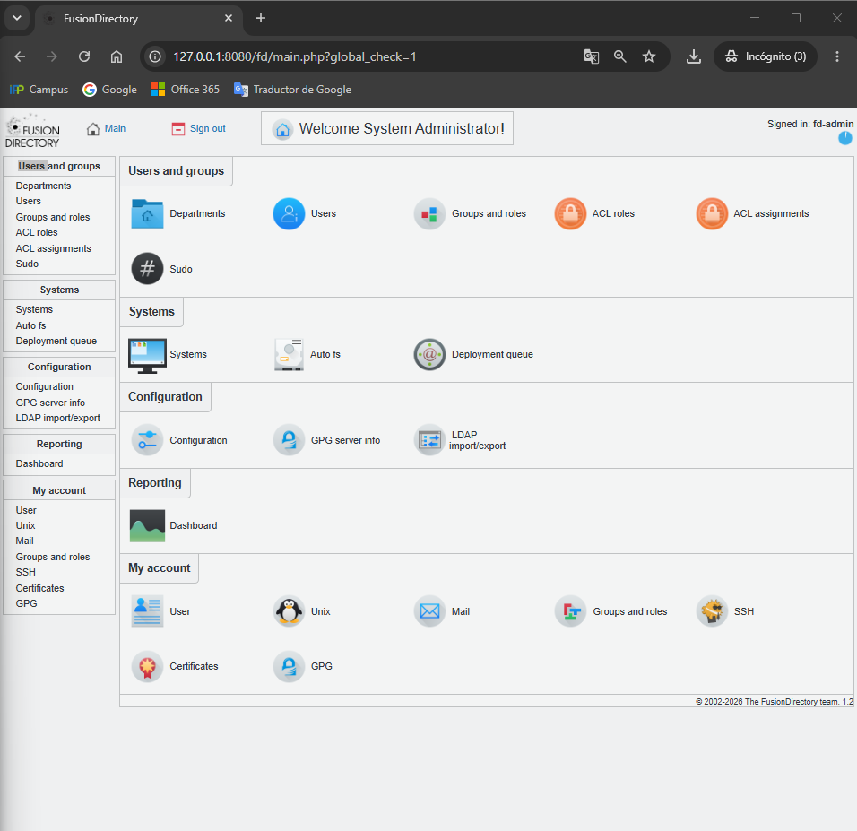
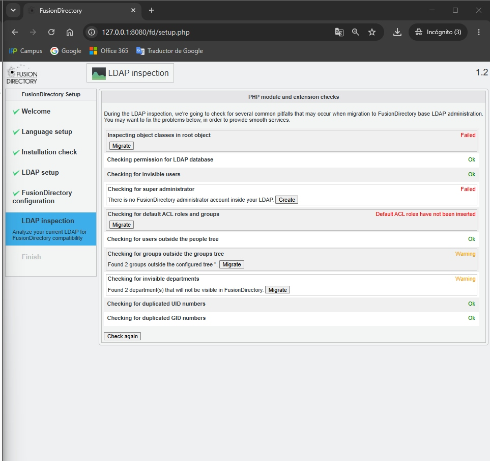
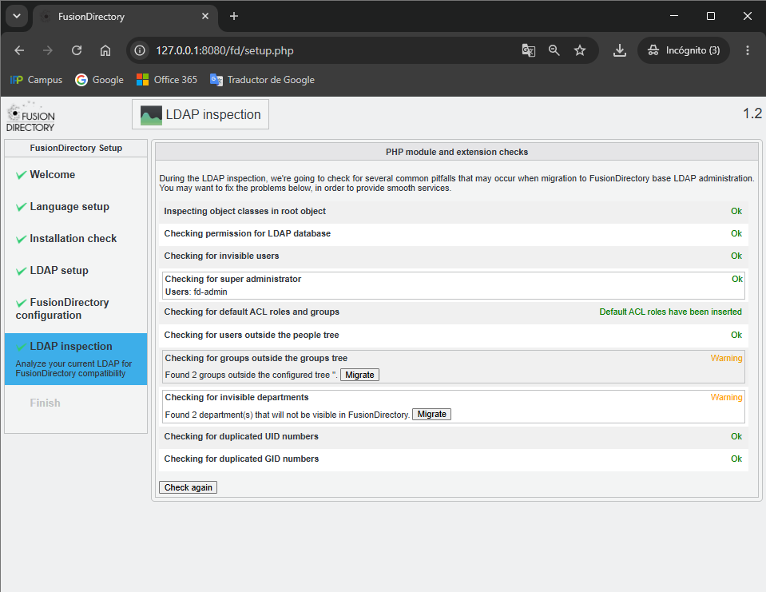
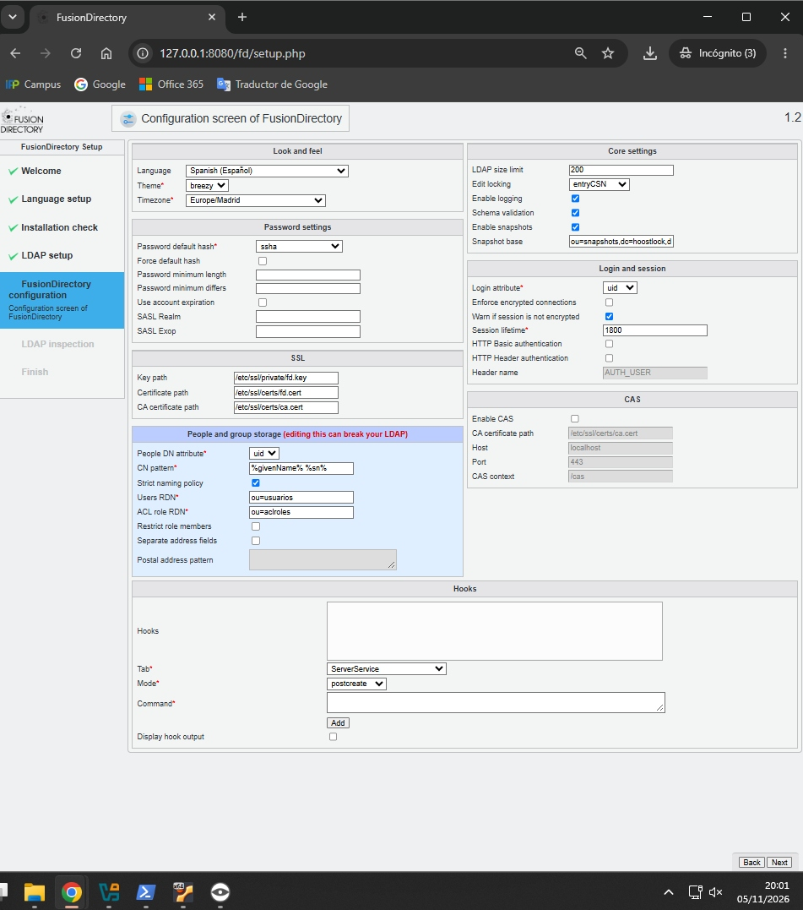
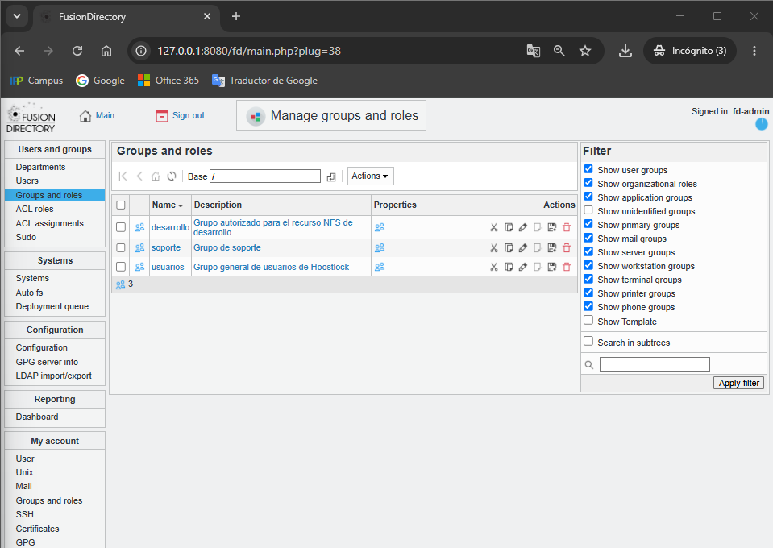

# ACT10 — Manual de operaciones: FusionDirectory, OpenLDAP y NFS

Profesor: Quim.

## 1. Objetivo y organización del manual

He estructurado este manual procedimental para documentar la instalación, configuración e integración de FusionDirectory sobre OpenLDAP y su posterior vinculación con recursos NFS restringidos mediante grupos del directorio.

El documento se organiza en tres partes:

- **Avance ejecutado:** operaciones ya realizadas y verificadas.
- **Despliegue mediante contenedores:** instalación de FusionDirectory y resolución de incidencias.
- **Pendientes y evidencias futuras:** tareas restantes y espacio reservado para nuevas capturas.

## 2. Contexto del entorno

La actividad se desarrolla sobre la infraestructura previa de OpenLDAP, utilizando FusionDirectory como interfaz de administración web del directorio.

| Elemento | Valor utilizado |
|---|---|
| Dominio LDAP | `dc=hoostlock,dc=lan` |
| Base DN | `dc=hoostlock,dc=lan` |
| Rama de usuarios | `ou=usuarios` |
| Rama de grupos POSIX | `ou=grupos` |
| Interfaz web | `http://127.0.0.1:8080/fd/` |
| Usuario administrador | `fd-admin` |
| Grupos existentes | `desarrollo`, `usuarios` |
| Grupo creado | `soporte` |

## 3. Avance ejecutado

### 3.1. Acceso a FusionDirectory

He accedido correctamente a la interfaz web de FusionDirectory con el usuario `fd-admin`.

La pantalla principal confirma el acceso administrativo:

```text
Welcome System Administrator!
Signed in: fd-admin
```



### 3.2. Revisión inicial del directorio

Antes de modificar la configuración, he comprobado el estado inicial del árbol LDAP y la presencia de las unidades organizativas y grupos existentes.



Tras la inicialización, he verificado que el directorio quedaba accesible para la administración web.



### 3.3. Configuración de la rama de grupos POSIX

He accedido a **Configuration → Plugins** y he configurado el parámetro:

```text
POSIX groups RDN = ou=grupos
```

Con este ajuste, FusionDirectory localiza los grupos POSIX en:

```text
ou=grupos,dc=hoostlock,dc=lan
```



### 3.4. Verificación de grupos existentes

Después de guardar la configuración, he accedido a **Groups and roles** y he comprobado que FusionDirectory muestra correctamente los grupos POSIX existentes:

- `desarrollo`
- `usuarios`

Esto confirma que la ruta `ou=grupos` está correctamente asociada a la administración de grupos POSIX.

### 3.5. Creación del grupo `soporte`

He creado un nuevo grupo POSIX con los siguientes valores:

| Campo | Valor |
|---|---|
| Base | `ou=grupos,dc=hoostlock,dc=lan` |
| Name | `soporte` |
| Force GID | Desactivado |
| GID | Asignación automática |
| Group members | Sin miembros iniciales |
| System trust | `disabled` |

El grupo ha quedado visible en la lista junto a `desarrollo` y `usuarios`.



## 4. Despliegue de FusionDirectory mediante contenedores

### 4.1. Arquitectura utilizada

He desplegado FusionDirectory separando los servicios en contenedores Docker. De esta forma, el servidor LDAP y la interfaz web permanecen aislados, pero pueden comunicarse entre sí.

| Componente | Función |
|---|---|
| `ladapserver` | Contenedor con OpenLDAP, donde se almacena el directorio y se cargan los esquemas |
| Contenedor web de FusionDirectory | Contenedor con Apache, PHP y FusionDirectory, publicado en `127.0.0.1:8080` |
| `fd-schema-source` | Contenedor que contiene los ficheros de esquema `.schema` necesarios para FusionDirectory |

La interfaz web de FusionDirectory se conecta al servidor LDAP mediante:

```text
ldap://host.docker.internal:389
```

De este modo, el contenedor web puede alcanzar el puerto `389` del servicio OpenLDAP publicado por el contenedor `ladapserver` en el equipo anfitrión.

### 4.2. Preparación del entorno de esquemas

En el contenedor `ladapserver` he creado un directorio de trabajo para almacenar los esquemas, las configuraciones temporales y los LDIF generados:

```bash
mkdir -p /root/fd-schemas
cd /root/fd-schemas
```

A continuación, he copiado desde el contenedor `fd-schema-source` los ficheros de esquema necesarios:

```bash
docker cp \
  "fd-schema-source:/etc/ldap/schema/fusiondirectory/<esquema>.schema" \
  ./<esquema>.schema
```

Este paso es necesario porque OpenLDAP no puede utilizar directamente los ficheros `.schema` de FusionDirectory en su configuración dinámica: primero deben convertirse al formato LDIF compatible con `cn=config`.

### 4.3. Conversión de esquemas a LDIF

Para convertir un esquema, he preparado una configuración temporal de `slapd` que incluye el fichero `.schema` correspondiente:

```bash
cp slapd.conf.test slapd.conf.<nombre>
printf "\ninclude /root/fd-schemas/<esquema>.schema\n" \
  >> slapd.conf.<nombre>
```

Después he utilizado `slaptest` para generar la estructura LDIF:

```bash
TMP=$(mktemp -d /root/fd-schemas/conversion.XXXXXX)
slaptest -f "$PWD/slapd.conf.<nombre>" -F "$TMP"
```

Del resultado he extraído las definiciones de atributos y clases para construir un LDIF válido para `cn=config`:

```ldif
dn: cn=<esquema>,cn=schema,cn=config
objectClass: olcSchemaConfig
cn: <esquema>
olcAttributeTypes: ...
olcObjectClasses: ...
```

Finalmente, he cargado el esquema en la configuración dinámica de OpenLDAP:

```bash
ldapadd -Q -Y EXTERNAL -H ldapi:/// -f <esquema>.ldif
```

### 4.4. Carga de los esquemas del núcleo

Antes de poder utilizar la configuración web de FusionDirectory, he cargado los esquemas base necesarios para el funcionamiento del núcleo:

- `core-fd-conf.schema`
- `template-fd-conf.schema`

Estos esquemas permiten que OpenLDAP reconozca la configuración principal de FusionDirectory almacenada en:

```text
cn=config,ou=fusiondirectory,dc=hoostlock,dc=lan
```

### 4.5. Incidencia: esquemas de plugins no cargados

**Síntoma**

Al intentar guardar la configuración desde la pestaña **Plugins** de FusionDirectory, el servidor LDAP devolvía errores de sintaxis inválida:

```text
LDAP operation failed!
Object: cn=config,ou=fusiondirectory,dc=hoostlock,dc=lan
Error: Invalid syntax - objectClass: fdAutofsPluginConf
```

Durante las sucesivas pruebas aparecieron errores similares con otras clases:

```text
fdSystemsPluginConf
fdWebservicePluginConf
fdMailPluginConf
fdSudoPluginConf
```

**Diagnóstico**

El error indicaba que OpenLDAP no reconocía las clases de configuración de varios plugins de FusionDirectory. La aplicación web estaba instalada, pero el servidor LDAP no disponía de los esquemas necesarios para almacenar su configuración.

**Causa**

La instalación de FusionDirectory incluye esquemas adicionales para cada plugin. Aunque los esquemas del núcleo habían sido cargados, no estaban cargados los ficheros `*-fd-conf.schema` correspondientes a plugins como AutoFS, Systems, Webservice, Mail y Sudo.

**Corrección aplicada**

He extraído todos los esquemas de configuración disponibles desde el contenedor `fd-schema-source`:

```bash
docker cp \
  "fd-schema-source:/etc/ldap/schema/fusiondirectory/." \
  ./all-fd-schemas/
```

Después he identificado los esquemas pendientes, los he convertido a LDIF y los he cargado en `cn=config`. Para evitar repeticiones, el procedimiento comprueba si ya existe un LDIF generado para cada esquema antes de procesarlo.

El proceso general ha sido:

1. Copiar los esquemas `*-fd-conf.schema` desde `fd-schema-source`.
2. Generar una configuración temporal que incluya los esquemas pendientes.
3. Convertirlos con `slaptest`.
4. Extraer los LDIF correspondientes.
5. Cargarlos con `ldapadd` mediante el socket local de OpenLDAP.

**Resultado**

Tras cargar los esquemas pendientes, he vuelto a la interfaz web y el guardado de la configuración de FusionDirectory se ha completado correctamente. A partir de ese momento, he podido configurar la rama de grupos POSIX y administrar los grupos del directorio.

## 5. Evidencias actuales

Las capturas disponibles se encuentran en [`evidencias/`](evidencias/).

| Captura | Contenido | Enlace |
|---|---|---|
| Acceso inicial | Acceso inicial a la interfaz web | [Ver captura](evidencias/fusiondirectory-01-acceso-web.png) |
| Acceso administrador | Sesión iniciada como `fd-admin` | [Ver captura](evidencias/fusiondirectory-acceso-administrador.png) |
| Requisitos | Comprobación de requisitos previos | [Ver captura](evidencias/fusiondirectory-comprobacion-requisitos.png) |
| Rama de usuarios | Configuración de la rama de usuarios y grupos | [Ver captura](evidencias/fusiondirectory-configuracion-rama-usuarios.png) |
| Grupo soporte | Grupo `soporte` creado y visible | [Ver captura](evidencias/fusiondirectory-grupo-soporte-creado.png) |
| Asistente | Inicio del asistente de configuración | [Ver captura](evidencias/fusiondirectory-inicio-asistente.png) |
| Inspección inicial | Inspección inicial del directorio | [Ver captura](evidencias/fusiondirectory-inspeccion-inicial.png) |
| Inspección final | Estado del directorio tras la inicialización | [Ver captura](evidencias/fusiondirectory-inspeccion-tras-inicializacion.png) |

## 6. Evidencias pendientes

Este apartado queda reservado para las capturas y salidas que se añadirán en las siguientes fases de la actividad.

### 6.1. NFS

- Instalación y configuración del servidor NFS.
- Creación del recurso compartido.
- Asignación de permisos POSIX al grupo autorizado.
- Configuración del cliente.
- Montaje del recurso NFS.

### 6.2. Verificación de acceso

- Reconocimiento de usuarios y grupos mediante `getent`.
- Acceso permitido con un usuario miembro del grupo autorizado.
- Acceso denegado con un usuario ajeno al grupo.
- Comprobación de escritura dentro del recurso compartido.

### 6.3. Comprobaciones finales

- Estado de los servicios OpenLDAP, NSS/SSSD y NFS.
- Configuración final del recurso compartido.
- Resumen de pruebas de segregación de acceso.

Las nuevas imágenes se añadirán en `evidencias/` con nombres descriptivos y se insertarán junto a la explicación correspondiente.

## 7. Próximos pasos

1. Documentar el despliegue del servidor NFS.
2. Crear y configurar el recurso compartido.
3. Asignar permisos mediante un grupo LDAP.
4. Configurar el cliente y montar el recurso.
5. Realizar las pruebas de acceso permitido y denegado.
6. Completar la sección de evidencias y conclusiones.

---

[← Volver al panel de actividades ASIXII](../README.md#actividades) · [Actividades de Quim](https://github.com/deivid-cardona/Base_de_datos-Quim#actividades)
