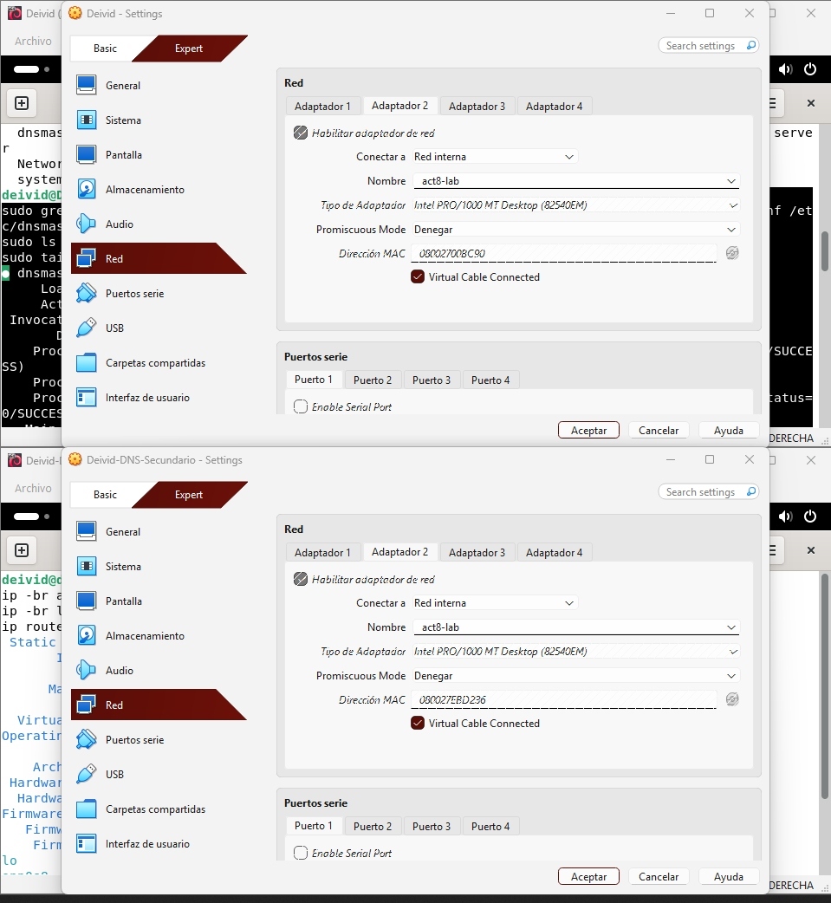
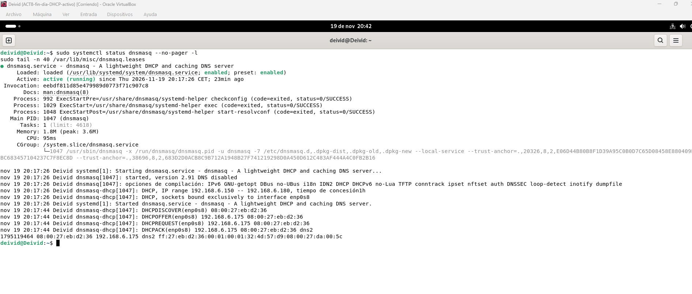
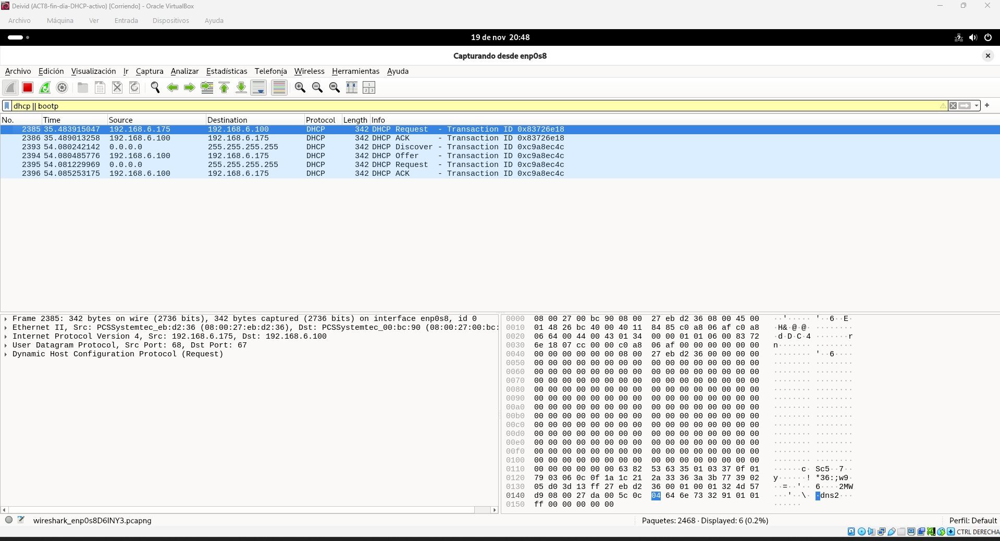
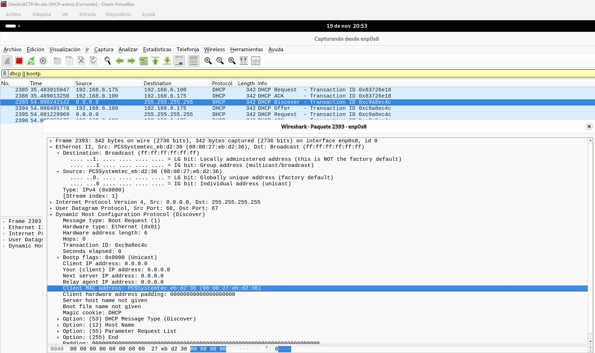
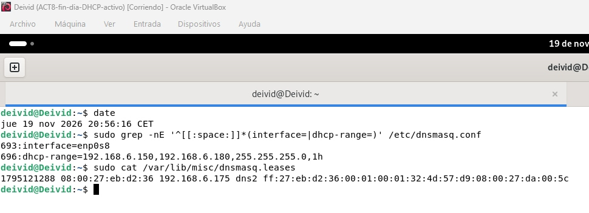
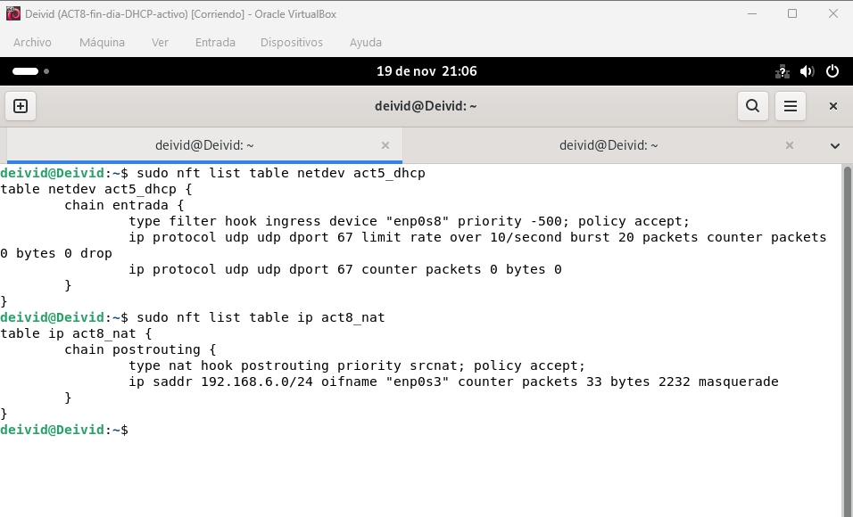
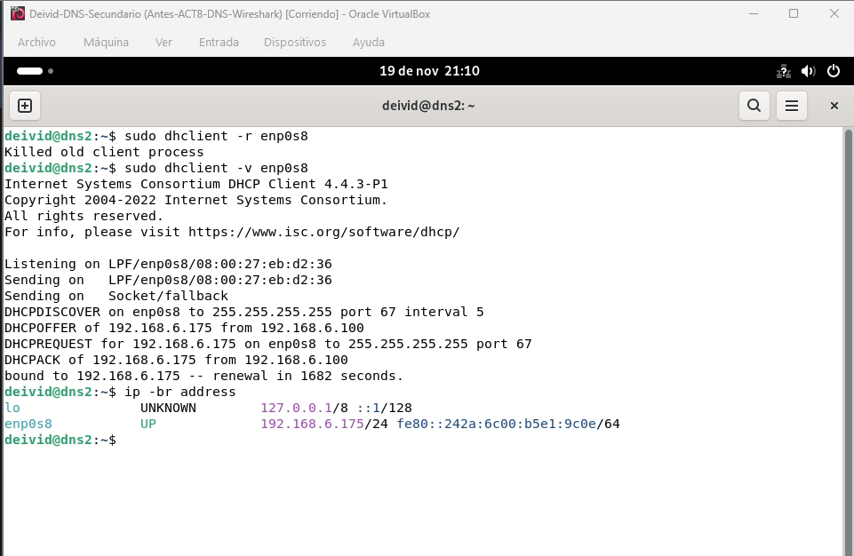
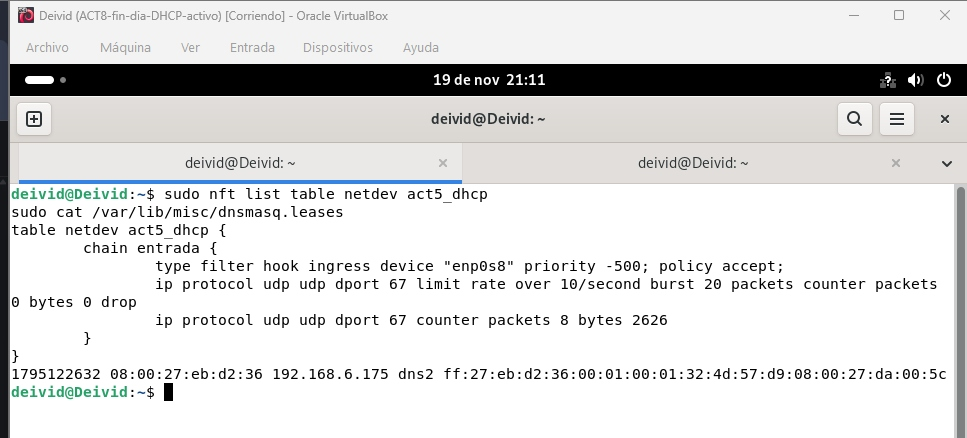

# ACT5 — Simulación DHCP Starvation

**Módulo:** 037 — Seguridad en servicios  
**Ciclo formativo:** ASIX  
**Alumno:** Deivid Cardona  
**Formato de entrega:** Informe documentado en GitBook personal.

## 1. Introducción y estado de la práctica

En esta actividad estudio el servicio DHCP y preparo un laboratorio para analizar el agotamiento de direcciones y sus mitigaciones. Hasta este momento he comprobado la asignación de una dirección al cliente legítimo, he capturado el proceso DORA, he comparado la MAC Ethernet con el campo `chaddr` y he configurado una limitación de tasa con nftables.

Todavía no he realizado la simulación de agotamiento ni he demostrado la eficacia de la defensa frente a tráfico excesivo. Distingo en este informe los resultados comprobados de las tareas pendientes.

Cualquier simulación de denegación de servicio la limitaré a un laboratorio propio, aislado y autorizado. Antes de esa fase verificaré el modo de conexión y todos los adaptadores de las máquinas participantes en VirtualBox.

## 2. Topología y revisión de las máquinas

He reutilizado las máquinas Debian 13 de las prácticas anteriores, sin borrar los archivos de BIND9. He revisado sus interfaces antes de continuar.

| Máquina | Interfaz | Dirección observada | Uso actual |
|---|---|---|---|
| Deivid | enp0s3 | 10.0.2.15/24 | Salida NAT |
| Deivid | enp0s8 | 192.168.6.100/24 | Servidor DHCP del laboratorio |
| dns2 | enp0s8 | 192.168.6.175/24 | Cliente DHCP legítimo |

He guardado la configuración de VirtualBox como evidencia de la topología de estas dos máquinas. Tener direcciones en la misma subred no demuestra por sí solo el aislamiento: debo comprobar también el modo y nombre de la red virtual. La incorporación y revisión de Kali como tercer equipo de pruebas sigue pendiente.



Para revisar las interfaces he utilizado:

```bash
hostnamectl
ip -br address
ip -br link
ip route
```

En la actividad anterior dns2 utilizaba 192.168.6.101 como DNS secundario. Ahora obtiene 192.168.6.175 por DHCP. Antes de volver a demostrar aquella práctica revisaré y recuperaré el direccionamiento y las comprobaciones de BIND9 correspondientes; no doy por verificada su continuidad solo por conservar los archivos.

## 3. Identificación del servidor y concesión inicial

Primero intenté consultar isc-dhcp-server, pero el servicio y sus archivos no existían. Después comprobé el puerto UDP 67 e identifiqué que el servidor DHCP instalado era dnsmasq.

```bash
sudo ss -lntup | grep -E ':67|:68'
sudo systemctl status dnsmasq --no-pager -l
sudo cat /var/lib/misc/dnsmasq.leases
```

He confirmado que dnsmasq escucha exclusivamente en enp0s8, tiene el servicio DNS desactivado y ofrece el rango 192.168.6.150–192.168.6.180, con concesiones de una hora. En el archivo de concesiones aparece dns2 con la MAC 08:00:27:eb:d2:36 y la dirección 192.168.6.175.



Mi implementación utiliza dnsmasq, aunque la topología de referencia del informe proponía ISC DHCP Server o Kea. Si el enunciado original exige uno de esos servicios, tendré que validar esta adaptación con el docente.

## 4. Captura del intercambio DORA

He iniciado una captura con Wireshark en enp0s8 de Deivid y he filtrado el tráfico DHCP. En dns2 he liberado y solicitado la concesión utilizando dhclient, después de disponer del cliente instalado.

```bash
sudo dhclient -r enp0s8
sudo dhclient -v enp0s8
ip -br address
```

En Wireshark he observado los mensajes Discover, Offer, Request y ACK. Así he relacionado la solicitud del cliente con la oferta y confirmación del servidor 192.168.6.100.



## 5. Comparación de la MAC Ethernet y chaddr

He seleccionado el DHCP Discover y he desplegado Ethernet II y DHCP. He comparado la MAC de origen de la trama con el campo Client MAC address, correspondiente a chaddr.

| Campo observado | Valor |
|---|---|
| MAC de origen Ethernet | 08:00:27:eb:d2:36 |
| Client MAC address / chaddr | 08:00:27:eb:d2:36 |

En este paquete ambos valores coinciden. Esta captura documenta un cliente legítimo; no demuestra una suplantación ni una prueba ejecutada con Scapy.



## 6. Estado inicial del pool

Antes de la simulación he documentado el rango configurado y las concesiones del servidor.

```bash
date
sudo grep -nE '^[[:space:]]*(interface=|dhcp-range=)' /etc/dnsmasq.conf
sudo cat /var/lib/misc/dnsmasq.leases
```

El rango configurado contiene 31 direcciones, desde .150 hasta .180, ambas incluidas. En la comprobación compartida aparece la concesión de dns2. Esta evidencia corresponde al estado previo, no a un pool agotado.



Pendiente: comparar este estado con el observado durante o después de la demostración autorizada y registrar el resultado del cliente legítimo.

## 7. Mitigación configurada con nftables

Al revisar el firewall he encontrado la tabla ip act8_nat con una regla masquerade para la salida de 192.168.6.0/24 por enp0s3. He conservado esa configuración y he añadido una tabla netdev independiente llamada act5_dhcp.

Antes del cambio he guardado las reglas:

```bash
sudo nft list ruleset | tee ~/nft-antes-mitigacion-dhcp.txt
```

Los comandos que he utilizado para crear la mitigación son los siguientes. No debo repetirlos si la tabla y las reglas ya existen.

```bash
sudo nft add table netdev act5_dhcp
sudo nft 'add chain netdev act5_dhcp entrada { type filter hook ingress device "enp0s8" priority -500; policy accept; }'
sudo nft 'add rule netdev act5_dhcp entrada ether type ip ip protocol udp udp dport 67 limit rate over 10/second burst 20 packets counter drop'
sudo nft 'add rule netdev act5_dhcp entrada ether type ip ip protocol udp udp dport 67 counter'
```

He configurado un límite global para DHCPv4 dirigido al puerto UDP 67 de enp0s8: 10 paquetes por segundo, con ráfaga de 20. La primera regla cuenta y descarta el exceso; la segunda cuenta el tráfico que no ha sido descartado por ella. No es un límite por cliente ni una garantía frente a todo agotamiento: solicitudes sostenidas por debajo del umbral también podrían consumir concesiones.

```bash
sudo nft list table netdev act5_dhcp
sudo nft list table ip act8_nat
```



No he configurado todavía la persistencia tras reiniciar. Si necesito retirar únicamente esta mitigación, utilizaré `sudo nft delete table netdev act5_dhcp`, sin vaciar el conjunto completo de reglas.

Como medidas teóricas complementarias estudio DHCP Snooping, Port Security y los límites por puerto en switches compatibles. No he implementado esas funciones en este laboratorio ni he configurado una comparación automática entre la MAC Ethernet y chaddr.

## 8. Comprobación del cliente después de configurar la defensa

Con las reglas instaladas he vuelto a liberar y solicitar la concesión desde dns2. He observado Discover, Offer, Request y ACK, y el cliente ha quedado con 192.168.6.175/24.



Después he revisado en Deivid:

```bash
sudo nft list table netdev act5_dhcp
sudo cat /var/lib/misc/dnsmasq.leases
```

En la comprobación he obtenido estos resultados:

| Elemento | Resultado observado |
|---|---|
| Contador de descarte | 0 paquetes, 0 bytes |
| Segunda regla DHCP | 4 paquetes, 1313 bytes |
| Concesión | dns2, 192.168.6.175 |
| MAC del cliente | 08:00:27:eb:d2:36 |



He comprobado que el cliente obtiene su dirección con la mitigación configurada y que no se han registrado descartes en esa comprobación. Todavía no he demostrado que el límite descarte tráfico excesivo ni que evite el agotamiento del pool.

## 9. Pruebas pendientes con Yersinia y Scapy

Todavía no he realizado ni documentado una prueba con Yersinia o Scapy. La inspección del Discover del cliente legítimo no sustituye esas partes de la actividad.

Antes de continuar, verificaré el tercer equipo y el aislamiento del laboratorio, guardaré el estado inicial y acordaré los límites de la demostración autorizada. Documentaré los cambios en concesiones, la respuesta del cliente y los contadores, diferenciando la prueba sin defensa de la prueba con defensa. Finalmente recuperaré el servicio y comprobaré su funcionamiento.

## 10. Análisis y conclusiones provisionales

He relacionado el proceso DORA con una concesión real y he observado por separado la MAC de Ethernet y chaddr. He identificado dnsmasq como servicio DHCP existente, evitando instalar otro servidor sin revisar previamente la máquina.

He conservado la regla NAT anterior y he añadido una limitación de tasa independiente. La renovación normal ha funcionado tras el cambio. Sin embargo, todavía no puedo concluir que haya demostrado DHCP Starvation ni una mitigación eficaz contra él: esas verificaciones siguen pendientes.

El modo promiscuo afecta a la observación del tráfico, pero no sustituye el aislamiento. Un bridge con inspección compatible podría permitir controles adicionales de capa 2; no he implementado esa solución. Tampoco confundo una lista de clientes permitidos con una validación de correspondencia entre Ethernet y chaddr.

## 11. Resumen de evidencias

| Nº | Evidencia | Estado |
|---|---|---|
| 1 | Topología de Deivid y dns2 | Captura incorporada; tercer equipo pendiente |
| 2 | Concesión inicial | Incorporada |
| 3 | Intercambio DORA | Incorporada |
| 4 | MAC Ethernet y chaddr | Incorporada |
| 5a | Pool antes de la simulación | Incorporada |
| 5b | Pool durante/después y efecto del agotamiento | Pendiente |
| 6 | Mitigación configurada | Incorporada; eficacia ante exceso pendiente |
| 7 | Cliente legítimo después de configurar la defensa | Incorporada |
| 7b | Contadores y concesión del servidor | Incorporada |
| — | Prácticas con Yersinia y Scapy | Pendientes |

## 12. Referencias

- [Scapy — documentación oficial](https://scapy.readthedocs.io/)
- [Kali Linux — Scapy](https://www.kali.org/tools/scapy/)
- [dnsmasq — manual](https://thekelleys.org.uk/dnsmasq/docs/dnsmasq-man.html)
- [nftables — manual en Debian 13](https://manpages.debian.org/trixie/nftables/nft.8.en.html)
- [RFC 2131 — DHCP](https://www.rfc-editor.org/rfc/rfc2131)
- [RFC 3118 — Authentication for DHCP Messages](https://www.rfc-editor.org/rfc/rfc3118)

---

[← Volver al panel de actividades](../README.md#actividades)
