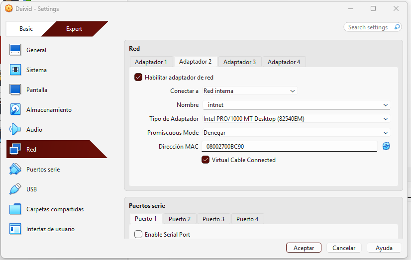
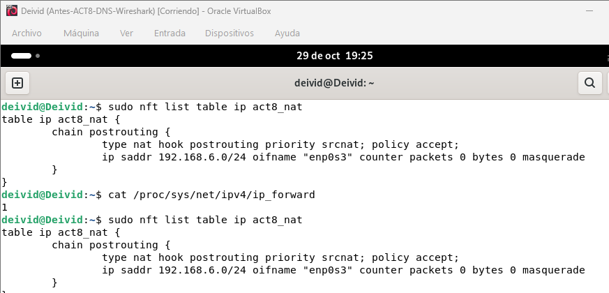
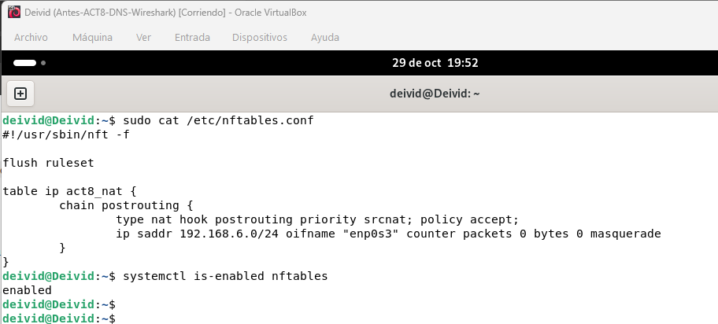
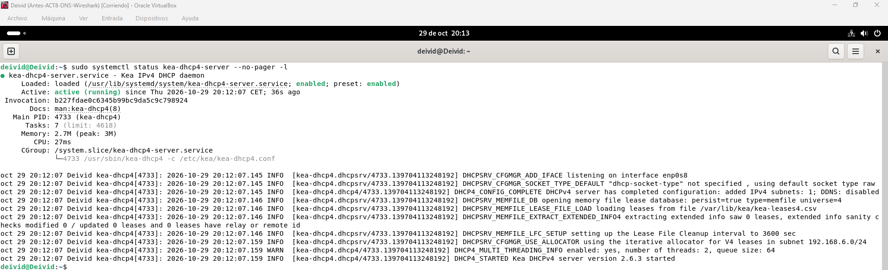

# Actividad 8 — Seguridad en DNS: análisis con Wireshark y DNS sobre HTTPS

## Índice

1. [Objetivo](#1-objetivo)
2. [Mi escenario de trabajo](#2-mi-escenario-de-trabajo)
3. [Preparación del laboratorio](#3-preparación-del-laboratorio)
4. [Consultas DNS y análisis con Wireshark](#4-consultas-dns-y-análisis-con-wireshark)
5. [Recorrido de una consulta DNS](#5-recorrido-de-una-consulta-dns)
6. [DNS sobre HTTPS](#6-dns-sobre-https)
7. [Evidencias y conclusiones](#7-evidencias-y-conclusiones)
8. [Entrega](#8-entrega)

## 1. Objetivo

En esta actividad analizaré el tráfico DNS con Wireshark y compararé las consultas convencionales con las realizadas mediante DNS sobre HTTPS (DoH).

He ubicado esta práctica en ACT8 de mi repositorio. El documento del enunciado se denomina ACT2-DNS-Wireshark.

## 2. Mi escenario de trabajo

He reutilizado las máquinas Deivid y dns2 de mi práctica DNSSEC.

| Máquina | Función anterior | Función para esta actividad | Dirección |
|---|---|---|---|
| Deivid | Servidor DNS principal con BIND9 | Servidor DNS con reenviador, DHCP y puerta de enlace | 192.168.6.100/24 en la red interna |
| dns2 | Servidor DNS secundario con BIND9 | Cliente con interfaz gráfica y navegador | 192.168.6.101 anteriormente; pendiente de adaptar a DHCP |

He preparado esta topología:

Internet → NAT de VirtualBox → Deivid → red interna internet → dns2.

El nombre internet identifica mi red interna de VirtualBox; no proporciona acceso a Internet por sí solo. He preparado dns2 sin una salida NAT propia para que utilice Deivid cuando complete la configuración del cliente.

## 3. Preparación del laboratorio

### 3.1 Conservación de mi práctica anterior

He creado una instantánea de cada máquina antes de adaptar el laboratorio. He mantenido separada mi documentación DNSSEC en dnssec/.

### 3.2 Red interna del servidor Deivid

He configurado el adaptador 2 de Deivid en Red interna con el nombre internet y he mantenido el adaptador 1 en NAT. Así he separado la conexión hacia el cliente de la conexión exterior.

### 3.3 Red interna del cliente dns2

He conectado el adaptador 2 de dns2 a la misma red interna internet y he deshabilitado el adaptador 1 para evitar una salida NAT independiente. Todavía no he comprobado su conectividad final.

### 3.4 Diagnóstico del servidor

He obtenido inicialmente el valor 0 al comprobar el reenvío IPv4. He encontrado nftables instalado y sin reglas activas.

He identificado enp0s3 como interfaz de salida, con dirección 10.0.2.15 y puerta de enlace 10.0.2.2, y enp0s8 como interfaz interna con dirección 192.168.6.100/24.

En BIND he encontrado los reenviadores 1.1.1.1 y 1.0.0.1, forward only, recursión y permiso de consulta para localhost y 192.168.6.0/24. He conservado esa configuración sin modificarla; todavía no he probado la resolución externa para esta actividad.

En mi consulta inicial de paquetes no he encontrado isc-dhcp-server ni kea-dhcp4-server. He encontrado dnsmasq-base, sin considerar su presencia una prueba de que DHCP estuviera configurado.

### 3.5 Reenvío IPv4 y NAT

He activado el reenvío IPv4, he guardado el ajuste en /etc/sysctl.d/99-act8-forward.conf y he comprobado el valor 1.

He creado la tabla act8_nat y una cadena postrouting con enmascaramiento para las conexiones de 192.168.6.0/24 que salen por enp0s3. He comprobado la regla masquerade y la prioridad srcnat.

En esta comprobación he obtenido contadores de 0 paquetes y 0 bytes. He verificado que la regla está cargada, pero todavía no que el cliente la utilice o tenga salida a Internet.

### 3.6 Persistencia del NAT

He guardado una copia del archivo anterior y he almacenado las reglas en /etc/nftables.conf. He validado el archivo sin errores y he habilitado nftables para cargarlo al arrancar.

En la comprobación final muestro la tabla act8_nat, la regla de enmascaramiento y el resultado enabled. He configurado la persistencia, pero todavía no he comprobado la carga de las reglas después de reiniciar.

### 3.7 Instalación y configuración DHCP

He instalado kea-dhcp4-server y he guardado una copia de la configuración original en /etc/kea/kea-dhcp4.conf.antes-act8. Después he preparado /etc/kea/kea-dhcp4.conf para mi red interna.

| Parámetro que he configurado | Valor |
|---|---|
| Interfaz | enp0s8 |
| Red | 192.168.6.0/24 |
| Identificador de subred | 1 |
| Rango de direcciones | 192.168.6.150–192.168.6.180 |
| Puerta de enlace entregada | 192.168.6.100 |
| Servidor DNS entregado | 192.168.6.100 |
| Duración de la concesión | 3600 segundos |
| Almacenamiento de concesiones | memfile con persistencia activada |

He dejado fuera del rango la dirección del servidor y la antigua dirección de dns2.

En la validación inicial como root he obtenido Unable to open file, aunque he podido leer el archivo. Después he realizado la validación como _kea y he obtenido mensajes que reconocen la subred y la interfaz, sin errores de configuración. No he determinado la causa del fallo inicial ni he considerado la validación una prueba de entrega de direcciones.

He reiniciado kea-dhcp4-server y he comprobado que su estado aparece como active (running). Con esta evidencia documento el servicio en ejecución. Todavía no he comprobado que dns2 reciba una concesión ni que tenga acceso a Internet.

### 3.8 Mi estado de avance

| Elemento | Estado de mi trabajo |
|---|---|
| Instantáneas y red de VirtualBox | He preparado ambas máquinas y conservado el estado anterior |
| Reenvío IPv4 y NAT | He activado el reenvío y cargado la regla |
| Persistencia NAT | He guardado y validado el archivo y habilitado el servicio; me falta comprobar el reinicio |
| DNS con reenviador | He revisado la configuración; me falta probar la resolución externa |
| DHCP en Deivid | He instalado y configurado Kea, validado como _kea y comprobado el servicio activo |
| Cliente dns2 | Me falta adaptar su configuración a DHCP y comprobar IP, rutas y DNS |
| Conectividad final | Me falta comprobar concesión, resolución y salida a Internet desde dns2 |
| Pruebas DNS y DoH | Todavía no las he realizado |

### 3.9 Mis siguientes pasos

1. Comprobaré qué herramienta gestiona la interfaz de dns2 y adaptaré el cliente a DHCP.
2. Revisaré el DNS utilizado y evitaré interferencias de su antigua configuración como secundario.
3. Verificaré la concesión DHCP, las rutas, la resolución externa y la salida a Internet.
4. Comprobaré la carga de las reglas tras reiniciar cuando verifique la persistencia.
5. Realizaré las capturas DNS y DoH y completaré el informe.

## 4. Consultas DNS y análisis con Wireshark

Consultaré tres dominios poco habituales y controlaré la caché cuando sea necesario para evitar que una respuesta anterior oculte el tráfico.

Utilizaré herramientas que generen consultas DNS o el navegador y capturaré el tráfico con Wireshark. Explicaré para cada petición los paquetes realmente observados, los protocolos, las direcciones, los puertos y si puedo leer el contenido. No asumiré un número fijo de paquetes.

### Mis resultados

Todavía no he seleccionado los dominios ni realizado estas consultas y capturas.

## 5. Recorrido de una consulta DNS

Prepararé un gráfico del recorrido real desde dns2 hasta Deivid, el reenvío hacia Internet y la respuesta al cliente. Elaboraré el diagrama definitivo después de comprobar la configuración y el tráfico; el esquema del apartado 2 representa mi topología de trabajo.

## 6. DNS sobre HTTPS

Activaré DoH en el navegador de dns2 y mostraré el navegador y la opción utilizada. Repetiré las peticiones a los mismos dominios y explicaré cómo las he observado con Wireshark, qué información puedo ver y qué diferencias encuentro respecto al DNS convencional.

Distinguiré el tráfico cifrado visible de una eventual inspección del contenido descifrado, si la realizo.

### Mis resultados

Todavía no he configurado DoH ni realizado la comparación.

## 7. Evidencias y conclusiones

He incorporado cinco capturas con explicaciones en primera persona. No duplicaré los comandos legibles en las imágenes y documentaré únicamente los resultados que haya comprobado.

| Evidencia | Archivo |
|---|---|
| Red interna de Deivid | [Captura 01](evidencias/01-red-interna-deivid.png) |
| Red interna de dns2 | [Captura 02](evidencias/02-red-interna-dns2.png) |
| Reenvío y NAT | [Captura 03](evidencias/03-reenvio-nat-deivid.png) |
| Persistencia NAT | [Captura 04](evidencias/04-persistencia-nat-deivid.png) |
| Servicio DHCP activo | [Captura 05](evidencias/05-servicio-dhcp-deivid.png) |

He preparado la red, el reenvío y el NAT, he configurado su persistencia y he puesto en ejecución Kea DHCPv4. Todavía no he demostrado el funcionamiento completo del escenario: me falta configurar y probar el cliente, comprobar la persistencia tras reiniciar y realizar el análisis DNS y DoH.

Mantendré separadas ACT2-dns-resolucion/ y dnssec/. Redactaré mis conclusiones finales a partir de las pruebas completas.

## 8. Entrega

Organizaré la documentación y las evidencias en GitHub y prepararé el informe en mi GitBook personal, cuya URL solicita el enunciado. Todavía no he incorporado el enlace de entrega.
