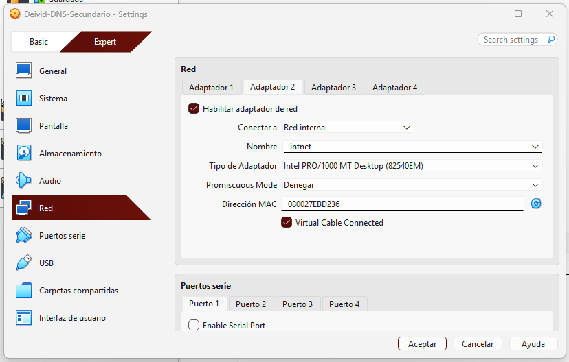
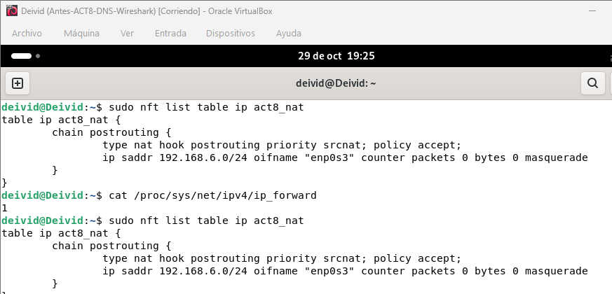
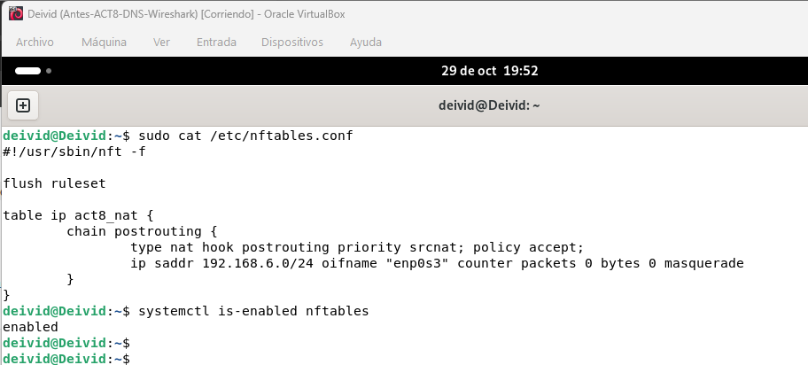
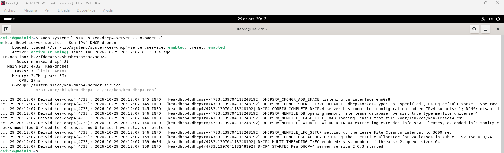
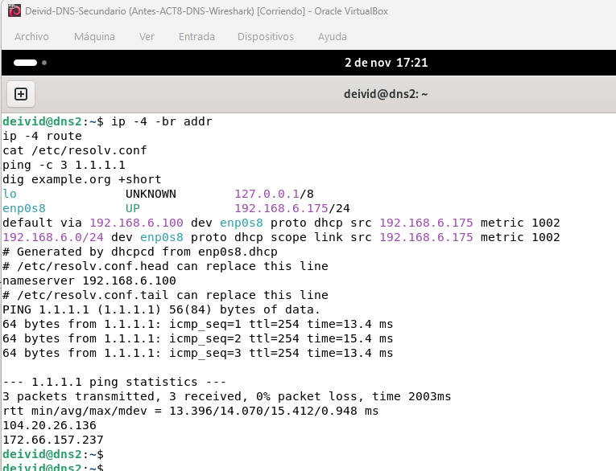
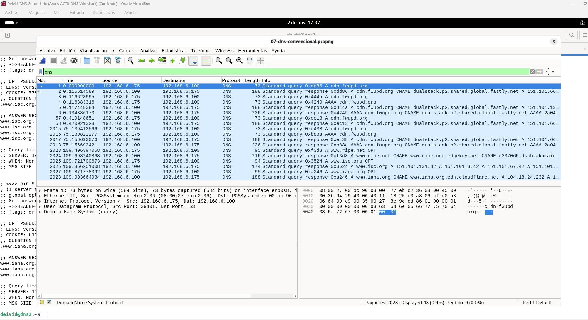
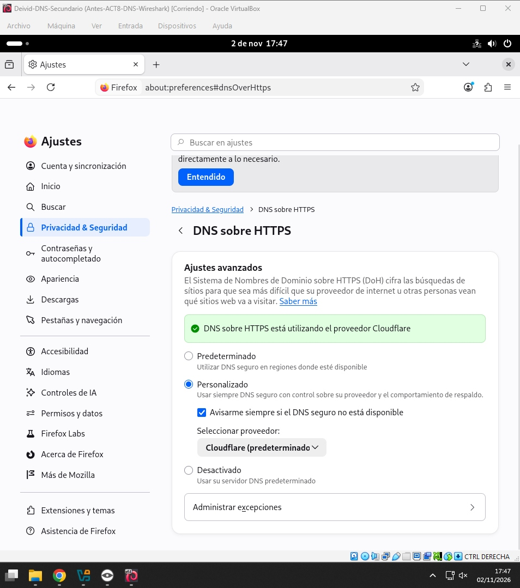

# Actividad 8 — Seguridad en DNS: Wireshark y DNS sobre HTTPS

## 1. Objetivo

He documentado la preparación de mi laboratorio DNS, la conectividad del cliente, las consultas DNS convencionales con Wireshark y la configuración de DNS sobre HTTPS en Firefox. He utilizado como referencia el enunciado ACT2-DNS-Wireshark y he mantenido esta actividad separada de mis prácticas de resolución DNS y DNSSEC.

## 2. Mi escenario de trabajo

He reutilizado las máquinas Deivid y dns2 del laboratorio DNSSEC y he creado una instantánea de cada una antes de adaptar su configuración.

| Máquina | Función en mi laboratorio | Dirección interna |
|---|---|---|
| Deivid | Servidor BIND9 con reenviadores, servidor DHCP y puerta de enlace | `192.168.6.100/24` |
| dns2 | Cliente con interfaz gráfica, Wireshark y Firefox | `192.168.6.175/24` en la comprobación |

He preparado el siguiente esquema de conexión:

```text
Internet
   |
NAT de VirtualBox
   |
Deivid
   |
Red interna: internet
   |
dns2
```

He utilizado `internet` como nombre de la red interna de VirtualBox. En Deivid he identificado `enp0s3` como interfaz exterior, con dirección `10.0.2.15` y puerta de enlace `10.0.2.2`, y `enp0s8` como interfaz interna, con dirección `192.168.6.100/24`.

## 3. Configuración de la red virtual

### 3.1. Servidor Deivid

He mantenido el adaptador 1 en NAT y he configurado el adaptador 2 en la red interna `internet` para separar la conexión exterior de la conexión con el cliente.


### 3.2. Cliente dns2

He conectado el adaptador 2 de dns2 a la misma red interna y he deshabilitado su adaptador 1 para evitar una salida NAT independiente.



## 4. Configuración del servidor

### 4.1. DNS con BIND9

He conservado los reenviadores `1.1.1.1` y `1.0.0.1`, el modo `forward only`, la recursión y el permiso de consulta para `localhost` y `192.168.6.0/24`.

### 4.2. Reenvío IPv4 y NAT

He activado el reenvío IPv4 y he guardado el ajuste en `/etc/sysctl.d/99-act8-forward.conf`. He comprobado que su valor es `1`.

He creado la tabla `act8_nat` y una cadena `postrouting` con prioridad `srcnat`. He configurado una regla `masquerade` para el tráfico de `192.168.6.0/24` que sale por `enp0s3`.



### 4.3. Configuración de carga al arranque

He guardado una copia del archivo anterior, he almacenado las reglas en `/etc/nftables.conf`, he validado el archivo sin errores y he habilitado `nftables` para su carga al arrancar. En esta comprobación he obtenido el estado `enabled`.



### 4.4. Servicio DHCP

He instalado `kea-dhcp4-server`, he conservado una copia de la configuración original en `/etc/kea/kea-dhcp4.conf.antes-act8` y he preparado `/etc/kea/kea-dhcp4.conf` con estos parámetros:

| Parámetro | Valor que he configurado |
|---|---|
| Interfaz | `enp0s8` |
| Subred | `192.168.6.0/24` |
| Identificador de subred | `1` |
| Rango de asignación | `192.168.6.150–192.168.6.180` |
| Opción de puerta de enlace | `192.168.6.100` |
| Opción de servidor DNS | `192.168.6.100` |
| Duración de la concesión | `3600` segundos |
| Almacenamiento | `memfile` con persistencia activada |

He dejado fuera del rango la dirección del servidor y la antigua dirección de dns2, `192.168.6.101`.

Durante la validación inicial como `root` he recibido `Unable to open file`. He repetido la validación como `_kea` y he obtenido el reconocimiento de la subred y la interfaz sin errores de configuración. Después he reiniciado el servicio y he comprobado su estado `active (running)`.



## 5. Comprobaciones del cliente

He revisado la dirección IPv4, las rutas y el servidor DNS de dns2. Después he probado la conectividad con una dirección externa y la resolución de un nombre.

| Comprobación | Resultado que he observado |
|---|---|
| Interfaz del cliente | `enp0s8` en estado `UP` |
| Dirección IPv4 | `192.168.6.175/24`, dentro del rango configurado en Kea |
| Ruta predeterminada | Mediante `192.168.6.100`, por `enp0s8`, con origen `192.168.6.175` y `proto dhcp` |
| Configuración DNS | `nameserver 192.168.6.100` en `/etc/resolv.conf`, generado por `dhcpcd` para `enp0s8` |
| Ping a `1.1.1.1` | 3 paquetes enviados, 3 recibidos y 0 % de pérdida |
| Resolución de `example.org` | `104.20.26.136` y `172.66.157.237` mediante `dig example.org +short` |

He comprobado que el cliente dispone de configuración asociada a DHCP, utiliza Deivid como puerta de enlace y servidor DNS, alcanza una dirección externa y obtiene respuestas de resolución de nombres. He separado la prueba de conectividad por IP de la prueba DNS para identificar qué acredita cada resultado.



## 6. Consultas DNS convencionales con Wireshark

### 6.1. Captura y dominios consultados

He abierto en Wireshark el archivo `07-dns-convencional.pcapng` y he aplicado el filtro de visualización `dns`. He identificado consultas y respuestas entre mi cliente `192.168.6.175` y el servidor `192.168.6.100`.

He localizado estos intercambios de las tres consultas de prueba:

| Dominio | Consulta y respuesta visibles | Información de la respuesta |
|---|---|---|
| `www.ripe.net` | Paquetes `2023` y `2024`, identificador `0xf3d3`, consulta `A` | Se muestra un `CNAME` hacia `www.ripe.net.edgekey.net` y otros datos de respuesta |
| `www.isc.org` | Paquetes `2025` y `2026`, identificador `0x3524`, consulta `A` | Se muestran direcciones como `151.101.131.42`, `151.101.3.42` y `151.101.67.42` |
| `www.iana.org` | Paquetes `2027` y `2028`, identificador `0x2466`, consulta `A` | Se muestra un `CNAME` hacia `www.iana.org.cdn.cloudflare.net` y la dirección `104.18.24.232` |

He asociado cada consulta con su respuesta mediante el identificador DNS y la inversión de las direcciones de origen y destino. Para estas tres consultas he identificado seis paquetes visibles: una consulta y una respuesta por dominio. He descrito únicamente la información legible en la captura, sin transcribir como completas las respuestas que aparecen truncadas en la columna de información.

### 6.2. Tráfico adicional y alcance del filtro

He distinguido las pruebas anteriores del tráfico adicional de `cdn.fwupd.org`, para el que aparecen consultas `A` y `AAAA`. No he contado esas peticiones como parte de los tres dominios de prueba.

He observado que Wireshark indica `2028` paquetes capturados y `18` mostrados con el filtro `dns`. Por tanto, he separado el total de tráfico capturado, los paquetes que pasan el filtro y los seis paquetes de las tres consultas identificadas.

### 6.3. Protocolos, puertos y contenido visible

He inspeccionado el primer paquete seleccionado, correspondiente a una consulta de `cdn.fwupd.org`. En su detalle he observado:

| Campo | Valor observado |
|---|---|
| Interfaz de captura | `enp0s8` |
| Capas mostradas | Ethernet II, IPv4, UDP y DNS |
| Dirección de origen | `192.168.6.175` |
| Dirección de destino | `192.168.6.100` |
| Puerto UDP de origen | `39401` |
| Puerto UDP de destino | `53` |
| Tamaño de la trama seleccionada | `73` bytes |

He atribuido estos puertos y este tamaño al paquete seleccionado, no a todas las consultas de la captura. He podido leer los nombres consultados y los datos de respuesta en Wireshark; en el panel de bytes también se distingue el nombre `cdn.fwupd.org`. Con ello he observado que el contenido DNS de este intercambio convencional es legible en la captura.



### 6.4. Recorrido de la consulta

He representado el tramo observado entre el cliente y Deivid, y he diferenciado la salida prevista por la configuración de reenviadores del servidor:

```text
Tramo observado en la captura del cliente:

dns2 (192.168.6.175)  -- consulta DNS -->  Deivid (192.168.6.100)
dns2 (192.168.6.175)  <-- respuesta DNS -- Deivid (192.168.6.100)

Salida configurada en Deivid para el reenvío DNS:

BIND9 en Deivid --> reenviadores 1.1.1.1 / 1.0.0.1
                    mediante su salida exterior
```

He utilizado la captura del cliente para describir los intercambios con Deivid y la configuración de BIND9 para representar sus reenviadores. No he atribuido a la captura del cliente una observación directa del tráfico entre Deivid y los reenviadores.

## 7. DNS sobre HTTPS en Firefox

He abierto la configuración de DNS sobre HTTPS desde `about:preferences#dnsOverHttps` en Firefox. He seleccionado `Personalizado`, he mantenido `Cloudflare (predeterminado)` como proveedor y he marcado `Avisarme siempre si el DNS seguro no está disponible`.

He comprobado que Firefox muestra el aviso verde: «DNS sobre HTTPS está utilizando el proveedor Cloudflare». He documentado este resultado como comprobación del estado indicado por el navegador.



## 8. Conclusiones

He preparado un laboratorio en el que Deivid proporciona servicios DNS y DHCP y actúa como puerta de enlace de la red interna. He comprobado que dns2 utiliza la dirección `192.168.6.175`, tiene configurados la puerta de enlace y el DNS `192.168.6.100`, alcanza `1.1.1.1` sin pérdida en la prueba de tres paquetes y resuelve `example.org`.

He identificado en Wireshark las consultas y respuestas de `www.ripe.net`, `www.isc.org` y `www.iana.org`, separándolas del tráfico adicional. He observado que los nombres y datos DNS son legibles y he documentado UDP con destino al puerto `53` en el paquete inspeccionado.

He activado DNS sobre HTTPS en Firefox y he comprobado el estado mostrado para Cloudflare. He mantenido diferenciadas las evidencias del tráfico DNS convencional y la comprobación de configuración del navegador.
