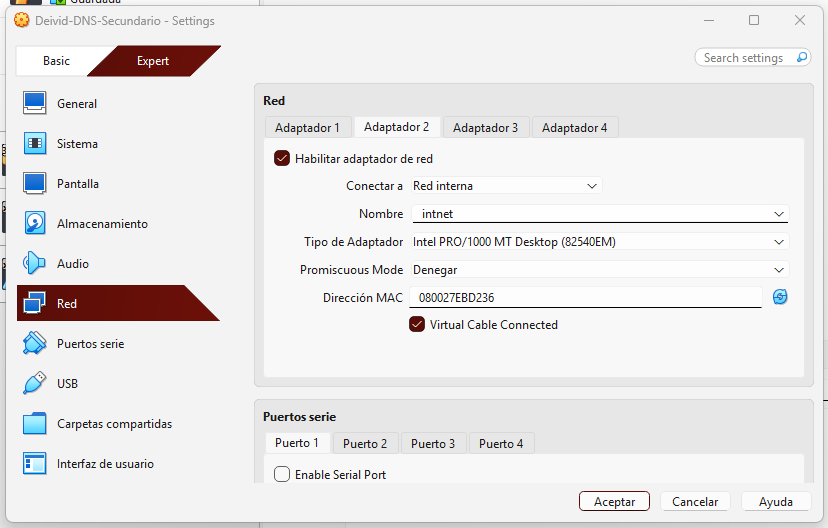
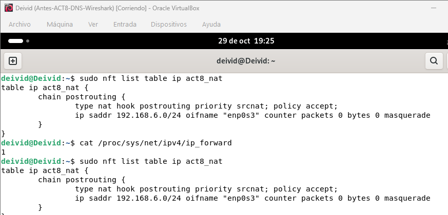
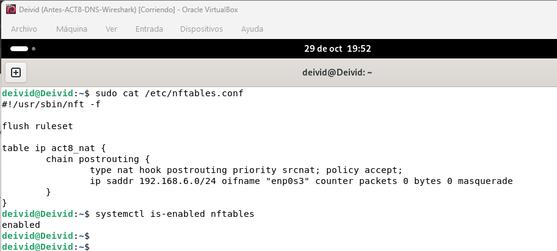
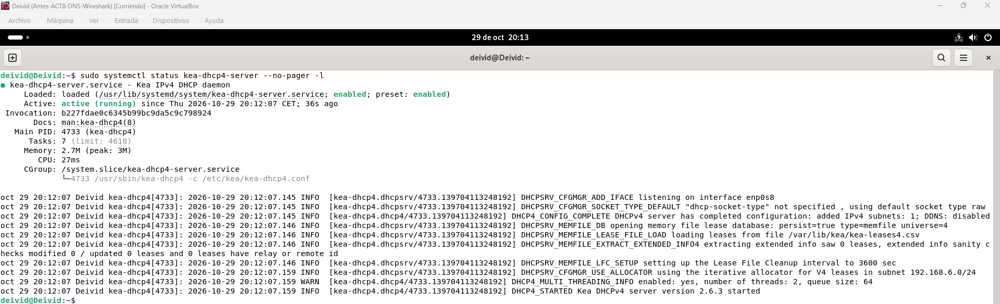
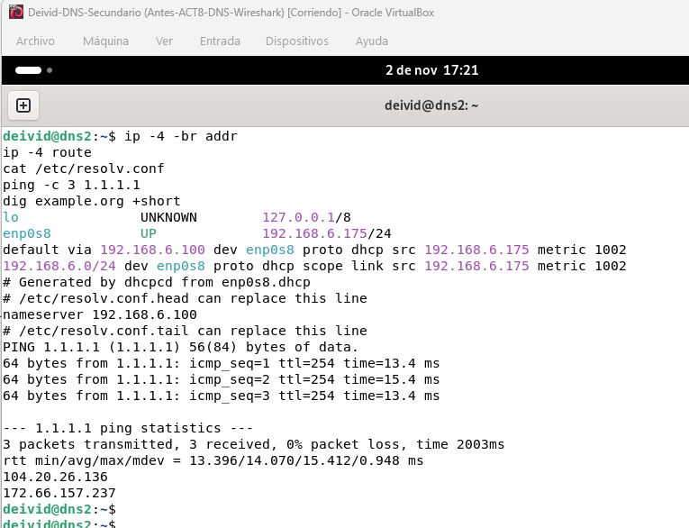
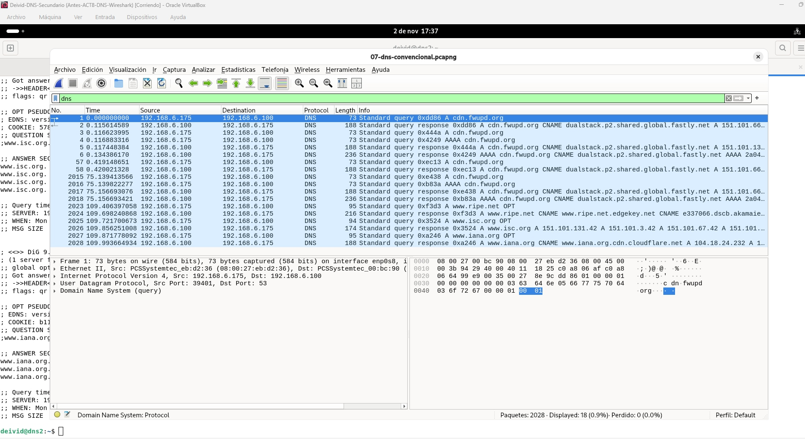
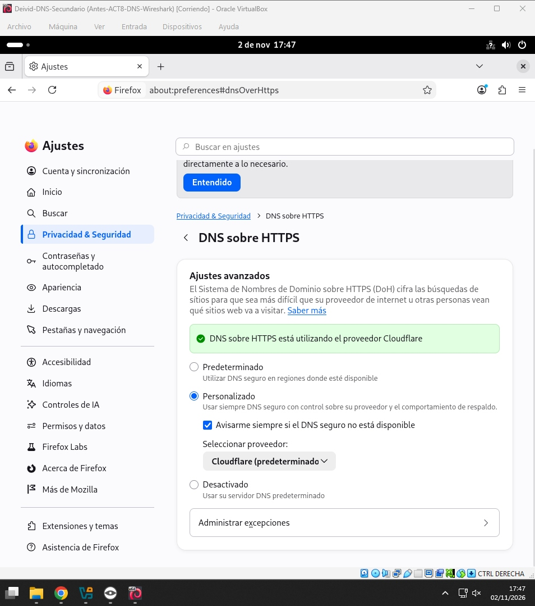

# Evidencias — DNS con Wireshark y DNS sobre HTTPS

[Volver al informe](../README.md)

## Índice de capturas

Las ocho capturas se conservan con su numeración y sus nombres actuales. Este índice las agrupa por fases del laboratorio; los títulos identifican cada archivo y no sustituyen el análisis de sus resultados.

| Nº | Fase | Evidencia |
|---|---|---|
| 01 | Red de VirtualBox | [Red interna de Deivid](01-red-interna-deivid.png) |
| 02 | Red de VirtualBox | [Red interna de dns2](02-red-interna-dns2.png) |
| 03 | Servidor y salida de red | [Reenvío IPv4 y NAT](03-reenvio-nat-deivid.png) |
| 04 | Servidor y salida de red | [Persistencia del NAT](04-persistencia-nat-deivid.png) |
| 05 | Servicio DHCP | [Servicio DHCP de Deivid](05-servicio-dhcp-deivid.png) |
| 06 | Cliente | [Conectividad de dns2](06-conectividad-dns2.png) |
| 07 | Análisis DNS | [Consultas DNS en Wireshark](07-consultas-dns-wireshark.png) |
| 08 | Configuración DoH | [DNS sobre HTTPS en Firefox](08-configuracion-doh-firefox.png) |

## 1. Red de VirtualBox

### 01 — Red interna de Deivid

### 02 — Red interna de dns2

## 2. Servidor: reenvío, NAT y DHCP

### 03 — Reenvío IPv4 y NAT

### 04 — Persistencia del NAT

### 05 — Servicio DHCP

## 3. Cliente y análisis DNS

### 06 — Conectividad de dns2

### 07 — Consultas DNS en Wireshark

## 4. DNS sobre HTTPS

### 08 — Configuración de Firefox

He seleccionado Personalizado, he mantenido Cloudflare como proveedor y he activado el aviso cuando el DNS seguro no esté disponible. En la captura aportada, el aviso verde de Firefox indica que DNS sobre HTTPS está utilizando el proveedor Cloudflare.

Esta evidencia documenta el estado mostrado por Firefox. No demuestra por sí sola una comparación del tráfico DNS convencional y DoH en Wireshark.

## Estado de la documentación

Este índice reúne ocho imágenes. El informe principal conserva apartados de una fase anterior que enumeran únicamente cinco capturas y describen DoH como pendiente; esas afirmaciones deben revisarse al integrar los resultados. La comparación de tráfico DoH y la persistencia tras reiniciar no se dan por verificadas en este índice.
