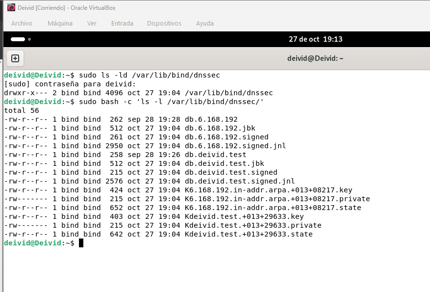
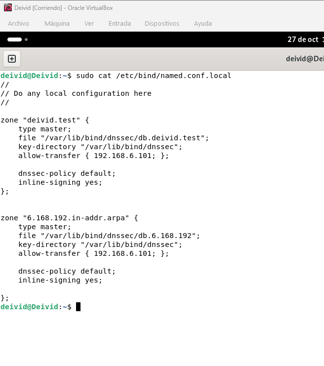
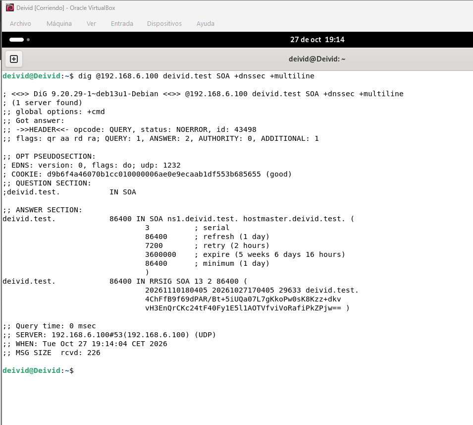
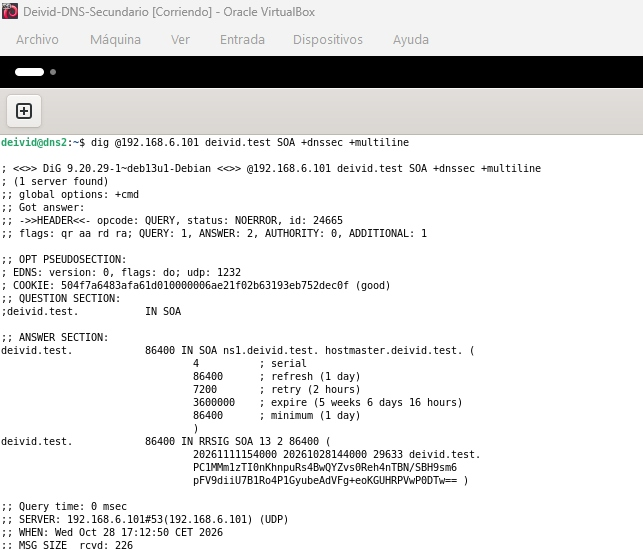
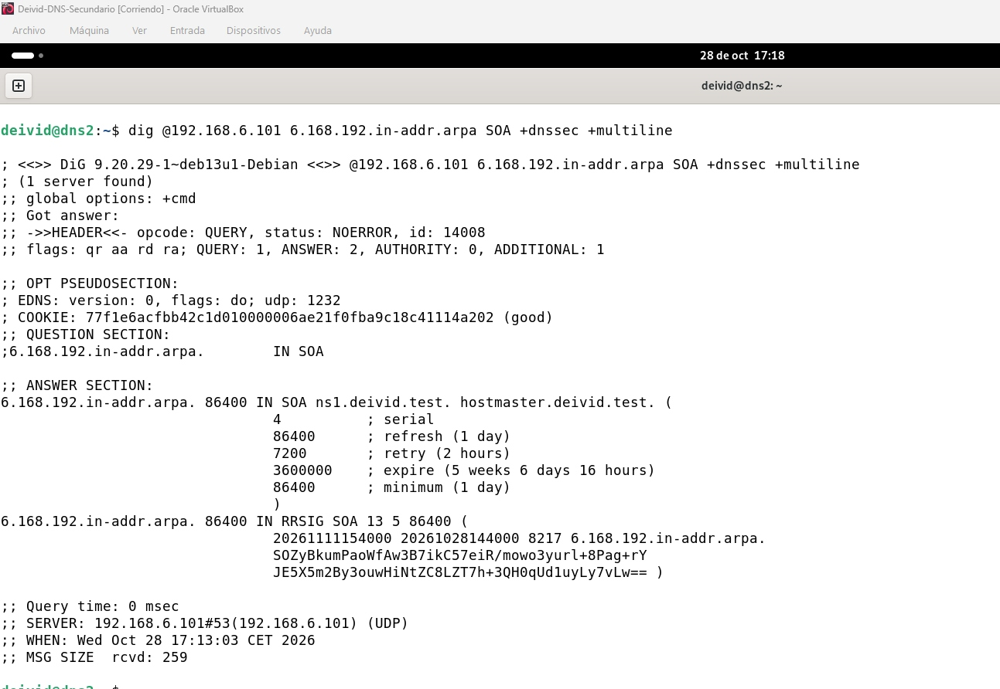
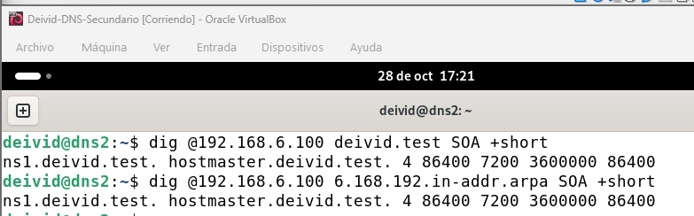

# Actividad 9 — DNSSEC con BIND9

## Índice

1. [Introducción](#1-introducción)
2. [Objetivos](#2-objetivos)
3. [Topología y escenario de partida](#3-topología-y-escenario-de-partida)
4. [Preparación del entorno](#4-preparación-del-entorno)
5. [Configuración de DNSSEC en el servidor principal](#5-configuración-de-dnssec-en-el-servidor-principal)
6. [Comprobación de la zona directa firmada](#6-comprobación-de-la-zona-directa-firmada)
7. [Comprobación del secundario](#7-comprobación-del-secundario)

## 1. Introducción

En esta actividad implemento DNSSEC en los servidores BIND9 de la práctica anterior. Utilizo un servidor principal, un servidor secundario y mi equipo Windows como cliente.

En este documento recojo los comandos que he utilizado, los cambios de configuración y los resultados de las pruebas, acompañados de sus capturas y explicaciones.

## 2. Objetivos

- Documentar la topología y la configuración inicial de los equipos.
- Implementar DNSSEC en las zonas del laboratorio.
- Comprobar el funcionamiento del servidor principal y del secundario tras los cambios.
- Realizar pruebas desde el cliente y explicar sus resultados.
- Analizar el consumo de recursos, la rotación de claves y la caducidad de las firmas según el enunciado.

## 3. Topología y escenario de partida

Para esta actividad reutilizo los dos servidores DNS de la práctica anterior de BIND9. El principal administra las zonas y el secundario recibe una copia mediante transferencia.

| Equipo | Nombre del equipo | Dirección IP | Función |
|---|---|---|---|
| Principal | Deivid | 192.168.6.100/24 | Administración y firma de las zonas |
| Secundario | dns2 | 192.168.6.101 | Recepción de las zonas mediante transferencia |
| Cliente | Equipo físico Windows | | Consultas desde el cliente |

| Elemento | Valor |
|---|---|
| Red de laboratorio | 192.168.6.0/24 |
| Zona directa | deivid.test |
| Zona inversa | 6.168.192.in-addr.arpa |
| Nombre DNS del principal | ns1.deivid.test |
| Versión de BIND en el principal | 9.20.29-1~deb13u1-Debian |

## 4. Preparación del entorno

### 4.1 Comprobaciones iniciales

Antes de modificar la configuración comprobé el nombre del equipo, sus direcciones IP, la versión de BIND y el estado del servicio:

```bash
hostname
ip -4 -br addr
sudo /usr/sbin/named -v
sudo named-checkconf
sudo systemctl status named --no-pager -l
```

El equipo principal tenía la dirección `192.168.6.100/24` en la interfaz `enp0s8`. El servicio `named` estaba activo y la comprobación de sintaxis no mostró errores.

Después revisé la configuración y el contenido de las zonas:

```bash
sudo cat /etc/bind/named.conf.local
sudo cat /etc/bind/named.conf.options
sudo cat /etc/bind/zones/db.deivid.test
sudo cat /etc/bind/zones/db.6.168.192
```

Las dos zonas estaban declaradas como `master` y permitían la transferencia al secundario `192.168.6.101`. La zona directa contenía el NS de `ns1` y su registro A; la inversa contenía el NS y el PTR de `192.168.6.100`.

Para comprobar las respuestas de los servidores ejecuté:

```bash
dig @192.168.6.100 deivid.test SOA +short
dig @192.168.6.101 deivid.test SOA +short
dig @192.168.6.101 ns1.deivid.test A +short
```

Ambos servidores devolvieron el serial `1` de la zona directa. Al consultar `ns1.deivid.test` al secundario obtuve `192.168.6.100`.

También comparé lecturas UTC de los equipos. No observé un desfase grande teniendo en cuenta el tiempo transcurrido entre los comandos, aunque el principal mostraba NTP inactivo y el reloj sin sincronización automática. En el registro de BIND aparecieron errores de conectividad con los reenviadores externos; las consultas a la zona local sí respondieron.

### 4.2 Copia de seguridad

Antes de cambiar la configuración guardé una copia de `/etc/bind`:

```bash
sudo cp -a /etc/bind "/root/bind-antes-dnssec-$(date +%Y%m%d-%H%M%S)"
```

Comprobé el contenido del respaldo con:

```bash
sudo bash -c 'ls -la /root/bind-antes-dnssec-*'
```

El listado mostró los archivos de configuración y la carpeta `zones`.

### 4.3 Directorio de trabajo para DNSSEC

Creé `/var/lib/bind/dnssec` y copié allí las dos zonas. Conservé los archivos originales en `/etc/bind/zones/`:

```bash
sudo install -d -o bind -g bind -m 750 /var/lib/bind/dnssec
sudo cp -p /etc/bind/zones/db.deivid.test /var/lib/bind/dnssec/
sudo cp -p /etc/bind/zones/db.6.168.192 /var/lib/bind/dnssec/
sudo chown bind:bind /var/lib/bind/dnssec/db.deivid.test /var/lib/bind/dnssec/db.6.168.192
```



En esta captura muestro el directorio de trabajo y los archivos de zona. Preparé la carpeta con permisos `750` y asigné las copias a `bind:bind` para que BIND pudiera trabajar con ellas. Esta evidencia corresponde a la preparación del almacenamiento; la comprobación de las respuestas firmadas aparece en el apartado 6.

## 5. Configuración de DNSSEC en el servidor principal

Edité `/etc/bind/named.conf.local` para utilizar las copias de las zonas y configurar la firma automática.



En esta captura muestro los dos bloques de zona de `named.conf.local`. Cambié las rutas para utilizar los archivos de `/var/lib/bind/dnssec/`, indiqué el directorio de claves y configuré `dnssec-policy default` junto con `inline-signing yes`. Mantuve `allow-transfer` con la IP del secundario. Para esta implementación utilicé la gestión automática de firma, no la generación manual de claves KSK y ZSK separadas.

Después comprobé la sintaxis y apliqué los cambios:

```bash
sudo named-checkconf
sudo rndc reconfig
```

La reconfiguración no mostró errores. A continuación consulté la zona directa para comprobar si el servidor devolvía su firma.

## 6. Comprobación de la zona directa firmada

Desde la terminal del principal consulté el registro SOA de `deivid.test` solicitando información DNSSEC.



En esta captura muestro la consulta del SOA de `deivid.test` al servidor `192.168.6.100`, solicitando información DNSSEC mediante `+dnssec`.

En la primera salida obtenida comprobé estos datos:

| Campo | Resultado observado |
|---|---|
| Estado de la consulta | NOERROR |
| Respuesta autoritativa | Indicador aa |
| Servidor que respondió | 192.168.6.100 |
| Serial del SOA | 3 |
| Firma del SOA | RRSIG SOA |
| Número de algoritmo en RRSIG | 13 |
| Identificador de clave | 29633 |

El registro `SOA` apareció acompañado de un `RRSIG SOA`. Con esta prueba comprobé que el principal sirve el SOA de la zona directa junto con su firma. El serial obtenido fue `3`, mientras que en la comprobación inicial había recibido `1`.

Esta respuesta demuestra la publicación del registro firmado, pero no constituye por sí sola una comprobación de validación de confianza desde el cliente. El indicador `aa` identifica la respuesta como autoritativa; no lo interpreto como una prueba de validación DNSSEC.

## 7. Comprobación del secundario

Después de configurar DNSSEC en el principal, comprobé que el servidor secundario había recibido y servía correctamente las zonas firmadas. Para ello consulté el registro SOA de la zona directa y de la zona inversa al secundario `192.168.6.101`, solicitando información DNSSEC.



En esta captura se observa la respuesta del secundario para `deivid.test`. El servidor devuelve el registro `SOA` acompañado de un registro `RRSIG SOA`, lo que indica que la zona directa se está sirviendo con DNSSEC desde `dns2`.



En esta segunda captura compruebo la zona inversa `6.168.192.in-addr.arpa`. También aparece el `RRSIG SOA`, por lo que el secundario está publicando la firma correspondiente además del registro SOA.

Para confirmar que el secundario estaba sincronizado con el principal, consulté después el serial de ambas zonas directamente al servidor principal `192.168.6.100`.



En esta captura se ven las dos consultas realizadas al principal. Ambas zonas devuelven el serial `4`, el mismo valor que había obtenido al consultar el secundario. Esto indica que la transferencia de zona se ha completado y que el secundario dispone de la versión actual de las zonas directa e inversa.

En conjunto, estas comprobaciones demuestran que el secundario no solo recibe las zonas, sino que también sirve sus registros SOA junto con las firmas DNSSEC. La coincidencia de seriales entre `192.168.6.100` y `192.168.6.101` confirma que ambas zonas están sincronizadas y firmadas en los dos servidores.
